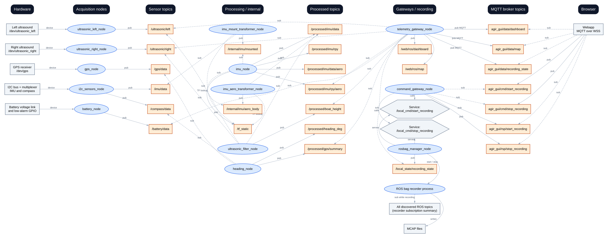

# Agir Sailing Team ROS 2

ROS 2 Jazzy workspace for the KTH Agir Sailing Team.

- [Docker setup for PC and Raspberry Pi](Docker/README.md)
- [Raspberry Pi 4 preparation and regatta updates](DAY_BEFORE_REGATTA/README.md)
- Sensor package: `ros2_ws/src/sensors`
- [Web communication: telemetry and rosbag commands](ros2_ws/src/communication_web/README.md)
- Data processing package: `ros2_ws/src/data_elaboration`
- Shared messages and services: `ros2_ws/src/sail_msgs`
- Live and replay launch package: `ros2_ws/src/orchestrator`

Inside the configured container:

```bash
bash /home/ros/ros2_ws/scripts/build.sh
bash /home/ros/ros2_ws/scripts/run.sh live
bash /home/ros/ros2_ws/scripts/run.sh replay
```

By default the build script cleans previous artifacts, loads ROS Jazzy, runs
`tools/gen_endpoints.py`, builds `sail_msgs`, then builds the complete workspace.
Set `PARALLEL_WORKERS` to override the default of two workers.
Use `bash scripts/build.sh --incremental` from `ros2_ws` to preserve build artifacts,
or `--clean` to explicitly rebuild from scratch. The quick Pi update uses incremental
mode unless the Docker image changes or you request a clean build.

The run script selects the corresponding launch in `orchestrator` and forwards
additional ROS launch arguments. Both modes now include sensor acquisition and
data processing. The live and replay sensor launches are intentionally identical
for now: both require the actual ultrasonic, GPS, I2C and GPIO hardware.
Replay does not start the battery shutdown policy and is not yet a bag-only mode.

Acquisition parameters live in `sensors/config/params.yaml`; processing parameters
live in `data_elaboration/config/params.yaml`. Each package's `endpoints.yaml`
defines its output topic names. Processing imports the generated sensor constants
for its inputs. See the package READMEs for the wiring and current limitations.

The communication package publishes `/web/ros/dashboard` and `/web/ros/map` and
forwards them to MQTT under `agir_gui/data/`. Set the broker for both gateways in
`communication_web/config/mqtt_config.yaml` before using the web link. Live includes
recording commands; replay includes only the telemetry gateway.

## Live architecture

One left-to-right overview of the live system. Blue ovals are ROS nodes; orange
rectangles are topics. Solid `pub` arrows go from publishers to topics. Dashed
`sub` arrows also point from nodes to topics and express subscription, not message
travel direction. Each topic is shown once, even when it has multiple subscribers.
Hardware access, service calls and process control have their own labels.

[](docs/architecture/live-architecture.svg)

Click the diagram to open the full-size vector image. Its column positions are
fixed so README renderers cannot rearrange the architecture vertically.
Edit the [Graphviz source](docs/architecture/live-architecture.dot) and regenerate
with `neato -Tsvg docs/architecture/live-architecture.dot -o docs/architecture/live-architecture.svg`.
A [PNG copy](docs/architecture/live-architecture.png) is available for sharing.

For example, `ultrasonic_left_node` publishes once on `/ultrasonic/left`; the
height filter and telemetry gateway both subscribe to that same topic. The IMU
conversion chain is not a feedback loop: the aero callback publishes only aero
outputs. Height uses robotic orientation; the dashboard uses aerospace angles.
`/tf_static` contains static transforms, not periodic measurements.

The recorder subscribes to discovered ROS topics (summarized in one box to avoid
an edge to every topic), including ROS dashboard/map copies; it does not capture
MQTT directly. Service edges describe caller/server roles. The battery node also
checks its shutdown policy; reaching the host depends on the Docker deployment.

Diagnostic topics, parameter events and unused transformer magnetometer ports
are omitted. Names come from package `config/endpoints.yaml` and launch remappings.
This is the live architecture, not the standalone MQTT simulator. Replay still
requires hardware. Inspect the running graph with `ros2 node list`,
`ros2 node info /NODE_NAME` and `ros2 topic info /TOPIC_NAME --verbose`.

## Where frequencies are configured today

These are source defaults in this checkout. The deployed/installed YAML and
runtime parameters may differ. A timer frequency is a requested callback rate,
not a guarantee of fresh sensor samples or an exact output frequency.
The table reflects the merged configuration, including the BNO085 UART driver.

| Node | Input reception / hardware acquisition | Computation | Publication | Configuration |
|---|---|---|---|---|
| `ultrasonic_left_node` | Reader thread waits for incoming serial data (`read_rate_hz: 0.0`); device frame rate is external | Parse complete frames as available; retain the latest valid sample and its decoding timestamp | Target 20 Hz on `/ultrasonic/left`, repeating the latest sample only while fresh (0.5 s maximum) | [sensors params](ros2_ws/src/sensors/config/params.yaml), `read_rate_hz`, `publish_rate_hz`, `max_sample_age_s` |
| `ultrasonic_right_node` | Independent reader, same arrival-driven mode as left | Same as left | Target 20 Hz on `/ultrasonic/right`, with the same freshness policy | sensors params, same three parameters |
| `gps_node` | Reader thread waits for incoming packets (`read_rate_hz: 0.0`); receiver output rate is external | Decode NAV-PVT and cache the latest solution, including `fix_valid=false`; other packets do not refresh its age | Target 10 Hz on `/gps/data`, preserving source stamps on repeats; stop after 1 s without new NAV-PVT | sensors params, `read_rate_hz`, `publish_rate_hz`, `max_sample_age_s` |
| `imu_sensor_node` | BNO085 over UART; wait for data (`read_rate_hz: 0.0`); request orientation/acceleration/gyro at 100 Hz and magnetometer at 50 Hz | Decode reports, check component freshness and cache fused orientation | Target 50 Hz on `/imu/data` and `/imu/mag`; repeats preserve timestamps, expire after 0.5 s | sensors params, `report_rate_hz`, `magnetometer_rate_hz`, `read_rate_hz`, `publish_rate_hz`, `max_sample_age_s` |
| `i2c_sensors_node`: compass | Worker reads requested at 10 Hz on the I2C mux | Conversion per read (unchanged 20 ms wait), snapshot caching | Independent target 10 Hz on `/compass/data`; retain source stamp on repeats, expire after 0.5 s | sensors params, `compass.read_rate_hz`, `compass.publish_rate_hz`, `compass.max_sample_age_s` |
| `battery_node` | Voltage decoded asynchronously from GPIO edges; sender sample rate is external. Low GPIO polled at 10 Hz | Cache voltage/alarm and evaluate shutdown on each successful read, independently of publication | Independent target 10 Hz on `/battery/data`; preserve GPIO stamp on repeats, stop after 0.5 s without a fresh alarm read; expired voltage becomes NaN after 5 s | sensors params, `read_rate_hz`, `publish_rate_hz`, `max_sample_age_s`, `voltage_max_age_s` |
| `imu_mount_transformer_node` | `/imu/data`, nominally up to 50 Hz | Transform each available input using TF | Input-driven `/internal/imu/mounted`, normally near input rate when TF is available | [processing params](ros2_ws/src/data_elaboration/config/params.yaml); no output timer |
| `imu_node` | Mounted IMU nominally up to 50 Hz; aero-body messages follow the 50 Hz robotic output | Use BNO085 fused orientation directly; process each new, fresh timestamp. Raw 6-DOF input retains the legacy filter | Target 50 Hz (`publish_rate_hz: 50.0`) for fresh cached robotic Imu; aero follows new transformed results immediately | processing params, `publish_rate_hz`, `max_sample_age_s` |
| `imu_aero_transformer_node` | `/processed/imu/data`, target 50 Hz | Transform each available input using TF | Input-driven `/internal/imu/aero_body`, normally near input rate | processing params; no output timer |
| `ultrasonic_filter_node` | Left target 20 Hz + right target 20 Hz + robotic IMU target 50 Hz | Store attitude history on IMU callbacks; reject repeated range timestamps and attempt projection/fusion for new samples | Target **20 Hz** for fresh cached `Float64Stamped` results; original stamps preserved, no publication after expiry | processing params, `publish_rate_hz` (0 means on-result), `max_range_age_s` |
| `telemetry_gateway_node` | Independently receives aero Imu up to ~50, height target 20, battery ~10, GPSFix ~10, left/right up to 20 each, state 2 Hz plus events | Cache on input callbacks; independent dashboard and map timers, each at 3 Hz. Latest live state cached for a separate 0.5 Hz MQTT timer | Each ROS dashboard/map topic at 3 Hz; each corresponding MQTT topic at 3 Hz; MQTT state at 0.5 Hz while manager updates are fresh | [communication params](ros2_ws/src/communication_web/config/params.yaml), `dashboard_publish_rate_hz`, `map_publish_rate_hz`, `recording_state_publish_rate_hz` |
| `command_gateway_node` | MQTT commands on demand; asynchronous service responses | Queue/timeouts checked every 0.05 s (20 Hz) | MQTT responses on demand, **not** 20 messages/s | communication params, `process_rate_hz` |
| `rosbag_manager_node` | Start/stop service requests on demand | Handle requests; independently check recorder process at 2 Hz | Periodic ROS state at 2 Hz, plus after start/stop handling and detected unexpected exits | [rosbag manager params](ros2_ws/src/rosbag_manager/config/params.yaml), `process_check_rate_hz`, `publish_rate_hz` |

The same node can have multiple input/output rates: summing the two IMU callbacks
into a single "node Hz" would hide what is actually happening. These are nominal
rates from code, not measurements on the Pi. Invalid inputs, missing TF, startup,
serial timeouts, I2C conversion waits and executor load can reduce actual throughput.
The BNO085 now owns its UART independently of the I2C compass. The compass
conversion wait remains 20 ms; its requested read rate is not a timing guarantee.
The battery's 100-baud link is a bit rate, not 100
voltage measurements/s. Both ultrasound callbacks can update the fused height;
its publication timer is independent and does not imply synchronized range pairs.

The live gateway therefore has a nominal baseline of **3 + 3 + 0.5 = 6.5 MQTT
publications/s** while sources are live; command responses add separate traffic. This is
different from the diagnostic simulator's 5 Hz dashboard + 2 Hz map + 0.5 Hz
recording state (7.5 publications/s). A successful simulator run does not prove
that the real gateway, hardware or exact live load behaves identically.

Current nodes read their rate parameters and create timers at startup. Changing
a YAML file requires restarting/relaunching with that file (and rebuilding or
installing updated configuration when needed). There is no implemented generic
live rate/mode switching mechanism. To measure an output, run, for example,
`ros2 topic hz /ultrasonic/left` or `ros2 topic hz /web/ros/dashboard` inside the
configured ROS environment; this measures reception, not the sensor's hardware ODR.

## Acquisition design and proposed publication controls

Agir should keep one owner per independent hardware interface: one node for each
serial sensor and one owner for the shared I2C bus/multiplexer. Processing nodes
consume typed ROS messages without opening those devices. This keeps hardware
failures and device-specific timing separate and lets recordings feed processing.

In the Polimi implementation inspected for comparison, `central_node` owns one
serial connection, drains its packets with `readAll()` and publishes packet IDs
and payloads on `/serial/raw_rx`. Sensor-specific nodes decode that shared
transport; GPS has its own launch. Its `loop_freq_hz: 150` is a serial polling
frequency, not a guarantee that every sensor produces 150 new samples/s. That
design fits a shared multiplexed transport. Agir's independent serial devices
do not need to be combined into a single raw topic just to centralize settings.

Keep timing settings in each package's YAML as the single source of configuration;
there is no second general rates file. Ultrasound and GPS separate `read_rate_hz`
(zero means wait for incoming data) from `publish_rate_hz` (20 Hz for ultrasound,
10 Hz for GPS by default).
See the [sensor documentation](ros2_ws/src/sensors/README.md#ultrasound-reading-and-publication)
for timestamp preservation, stale-sample expiry and custom YAML migration.

Dashboard and map publication timers are now independent:

```yaml
telemetry_gateway_node:
  ros__parameters:
    dashboard_publish_rate_hz: 3.0
    map_publish_rate_hz: 3.0
```

Recording-state ROS publication and process checks are configured at 2 Hz in the
manager's YAML. MQTT state publication is independently configured at 0.5 Hz in
the gateway. State changes publish immediately on ROS and reach MQTT at the next
state tick; command responses are sent independently when ready.
These gateway rates must be positive; on-data is not implemented for web outputs.
General design guidance for the rest of the system:

- `on_data`: publish when a new valid sample/result is available, even if its
  numeric value equals the previous one. This is different from publishing only
  when a value changes. For a multi-input computation, specify which inputs
  trigger computation and how timestamp alignment/age limits are checked.
- `periodic`: publish the most recent usable result at the requested frequency.
  Do not accumulate a FIFO of old snapshots to replay later. Preserve acquisition
  timestamps and distinguish repeated samples, stale data and a missing source.
- Keep acquisition timing separate from output timing. Serial reception must
  continue draining data even when publishing slowly; I2C polling/data-ready and
  device ODR remain hardware concerns. GPS now continuously decodes packets by
  default and drains buffered packets when periodic reading is selected.
- Estimators should normally process every useful new sample, then optionally
  limit outgoing updates. Reducing an IMU filter's computation rate changes its
  behavior; it is not just a display-bandwidth choice. Similarly, do not reduce
  battery alarm/shutdown checking just to reduce outgoing telemetry frequency.
- Keep web dashboard and map snapshots independently rate-limited and retain a
  periodic recording-state heartbeat (for example every 2 s), even when immediate
  state-change updates are also provided. Broadcasting every sensor callback to
  MQTT would combine their rates into a potentially much higher message load.
- Implement startup selection first with validated modes/positive finite rates.
  Runtime parameter changes additionally need callbacks that safely replace timers
  and avoid duplicate publication; a successful `ros2 param set` alone is not proof
  that an existing timer changed.

Recording-state timing and independent web output timers are implemented. Remaining
validation should measure effective source/output rates and disconnect behavior
on the Raspberry, with the real sensors and web app.
For MQTT latency/disconnection tests without ROS or a Raspberry, use
[the standalone MQTT diagnostics](tools/mqtt_diagnostics/README.md). It includes
a local Mosquitto broker, synthetic dashboard/map data, native and WebSocket
observers, and CSV/JSON reports for comparing local and cloud brokers.
