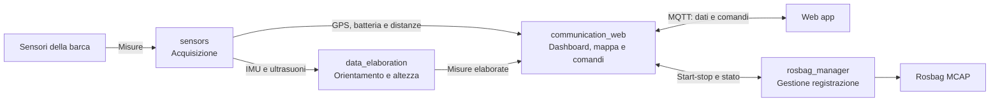

# Workspace ROS 2

_Aggiornato al giorno: 30/10/2026_

[English](README_ENG.md) · [Repository principale](../README.md)

## Introduzione

Il workspace contiene il software che legge i sensori della barca, ricava orientamento e altezza, comunica con la web app e registra le prove. Qui trovi una panoramica di come questi compiti sono distribuiti; i README dei singoli pacchetti spiegano poi nodi, topic e parametri.

Durante lo sviluppo e a bordo, il workspace viene usato nel container Docker, dove si trova in `/home/ros/ros2_ws`.

## Struttura e pacchetti

I sorgenti sono in `src/`. La tabella segue l'ordine delle cartelle e rimanda alla documentazione di ciascun componente.

| Percorso | Scopo | README dettagliato |
|---|---|---|
| `rosbags/` | Registrazioni da conservare, analizzare o riprodurre. | [Strumenti per le bag](tools/README.md) |
| `scripts/` | Comandi per compilare, avviare e verificare il workspace. | [Script](scripts/README.md) |
| `src/communication_web/` | Prepara dashboard e mappa, scambia dati e comandi MQTT con la web app. | [communication_web](src/communication_web/README.md) |
| `src/data_elaboration/` | Corregge il montaggio IMU e stima l'altezza della barca. | [data_elaboration](src/data_elaboration/README.md) |
| `src/orchestrator/` | Avvia insieme i componenti per il funzionamento live o il replay. | [orchestrator](src/orchestrator/README.md) |
| `src/rosbag_manager/` | Avvia e ferma le registrazioni e ne pubblica lo stato. | [rosbag_manager](src/rosbag_manager/README.md) |
| `src/sail_common/` | Raccoglie la funzione condivisa per controllare la freschezza delle misure. | [sail_common](src/sail_common/README.md) |
| `src/sail_msgs/` | Definisce i messaggi e i servizi specifici di Agir. | [sail_msgs](src/sail_msgs/README.md) |
| `src/sensors/` | Legge seriali, I2C e GPIO e pubblica le misure dei sensori. | [sensors](src/sensors/README.md) |
| `tools/` | Genera gli endpoint ed esporta le rosbag in CSV. | [Strumenti](tools/README.md) |

Le cartelle `build/`, `install/` e `log/` vengono create durante la compilazione: non contengono i sorgenti da modificare.

## Come interagiscono i pacchetti

Il diagramma mostra il percorso delle misure e dei comandi da sinistra a destra. Le frecce rappresentano scambi logici tra componenti, non l'elenco completo dei topic ROS.

`sensors` rende disponibili le misure. `data_elaboration` usa IMU e ultrasuoni per correggere l'orientamento e stimare l'altezza; GPS e batteria arrivano invece direttamente a `communication_web`. Quest'ultimo prepara ciò che serve alla dashboard e alla mappa e lo invia alla web app attraverso il broker MQTT.

Il percorso dei comandi va nella direzione opposta. Le richieste di registrazione vengono inoltrate a `rosbag_manager`; il ping di una boa viene gestito dentro `communication_web`, salvando la posizione GPS attuale per il tipo scelto.

Il manager avvia un processo `ros2 bag record`, che si sottoscrive ai topic dei sensori, dell'elaborazione e dei gateway. Questi collegamenti di registrazione sono approfonditi nel suo README. La registrazione parte su richiesta, non appena si avvia il sistema.

Tre pacchetti completano questa organizzazione:

- **`orchestrator`** sceglie quali componenti avviare; non trasporta le misure.
- **`sail_msgs`** definisce le strutture dei messaggi e dei servizi condivisi.
- **`sail_common`** fornisce il controllo di freschezza richiamato dai nodi.

## Sistema dal vivo e replay

In modalità **live**, i nodi di acquisizione leggono l'hardware e il sistema può ricevere comandi dalla web app e registrare.

Nel **replay**, una bag fornisce le misure già registrate. Si avviano solo elaborazione e telemetria, usando l'orologio della bag; i nodi dei sensori, il command gateway e il manager di registrazione restano esclusi. Il replay serve quindi a ricalcolare e osservare i risultati senza collegare i sensori.

Per i comandi consulta [orchestrator](src/orchestrator/README.md) e gli [script del workspace](scripts/README.md).

## Dove modificare il sistema

Le frequenze, i montaggi e le soglie stanno nei file `config/params.yaml` dei pacchetti interessati. I nomi dei topic e dei servizi stanno in `config/endpoints.yaml`: la build genera da questi file le costanti usate dal codice. Modifica gli YAML, non i file generati.

Quando aggiungi o cambi una misura, parti dal README del pacchetto che la produce e segui i collegamenti verso chi la usa. I diagrammi locali mostrano quei topic e servizi senza ripetere tutto il sistema.
