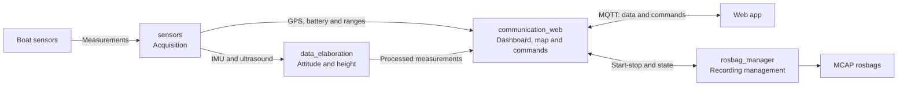

# ROS 2 workspace

_Updated on: 30/10/2026_

[Italiano](README.md) · [Main repository](../README_ENG.md)

## Introduction

The workspace contains the software that reads the boat's sensors, computes attitude and height, communicates with the web app and records tests. This page explains how those responsibilities are divided; individual package READMEs then describe nodes, topics and parameters.

During development and on the boat, the workspace runs inside Docker at `/home/ros/ros2_ws`.

## Structure and packages

Source code lives in `src/`. The table follows directory order and links to each component's documentation.

| Path | Purpose | Detailed README |
|---|---|---|
| `rosbags/` | Recordings to keep, analyse or replay. | [Bag tools](tools/README_ENG.md) |
| `scripts/` | Commands for building, running and checking the workspace. | [Scripts](scripts/README_ENG.md) |
| `src/communication_web/` | Prepares dashboard and map data; exchanges MQTT data and commands with the web app. | [communication_web](src/communication_web/README_ENG.md) |
| `src/data_elaboration/` | Corrects IMU mounting and estimates boat height. | [data_elaboration](src/data_elaboration/README_ENG.md) |
| `src/orchestrator/` | Starts the components for live operation or replay. | [orchestrator](src/orchestrator/README_ENG.md) |
| `src/rosbag_manager/` | Starts and stops recordings and publishes their state. | [rosbag_manager](src/rosbag_manager/README_ENG.md) |
| `src/sail_common/` | Provides the shared measurement freshness check. | [sail_common](src/sail_common/README_ENG.md) |
| `src/sail_msgs/` | Defines Agir-specific messages and services. | [sail_msgs](src/sail_msgs/README_ENG.md) |
| `src/sensors/` | Reads serial, I2C and GPIO interfaces and publishes sensor measurements. | [sensors](src/sensors/README_ENG.md) |
| `tools/` | Generates endpoints and exports rosbags to CSV. | [Tools](tools/README_ENG.md) |

The `build/`, `install/` and `log/` directories are generated during compilation; they do not contain the source files to edit.

## How the packages interact

The diagram shows the path of measurements and commands from left to right. Arrows represent logical exchanges between components, rather than every ROS topic.

`sensors` makes measurements available. `data_elaboration` uses IMU and ultrasound to correct attitude and estimate height; GPS and battery instead go directly to `communication_web`. That package prepares dashboard and map data and sends it to the web app through the MQTT broker.

Commands travel in the other direction. Recording requests go to `rosbag_manager`; buoy ping is handled inside `communication_web`, saving the current GPS position for the selected buoy type.

The manager starts a `ros2 bag record` process that subscribes to sensor, processing and gateway topics. Its README details those recording connections. Recording starts on request, not automatically with the system.

Three packages complete this arrangement:

- **`orchestrator`** selects the components to start; it does not carry measurements.
- **`sail_msgs`** defines shared message and service structures.
- **`sail_common`** provides the freshness check called by nodes.

## Live operation and replay

In **live** mode, acquisition nodes read the hardware, and the system can receive web app commands and record.

During **replay**, a bag supplies previously recorded measurements. Only processing and telemetry run, using the bag clock; sensor nodes, the command gateway and recording manager are excluded. Replay therefore lets you recalculate and inspect results without connecting sensors.

For commands, see [orchestrator](src/orchestrator/README_ENG.md) and the [workspace scripts](scripts/README_ENG.md).

## Where to make changes

Rates, mounting geometry and thresholds live in the relevant packages' `config/params.yaml` files. Topic and service names live in `config/endpoints.yaml`; the build generates the constants used by code from these files. Edit the YAML files, not the generated files.

When adding or changing a measurement, start with the producer package's README and follow its links to the consumers. Local diagrams show those topics and services without repeating the entire system.
