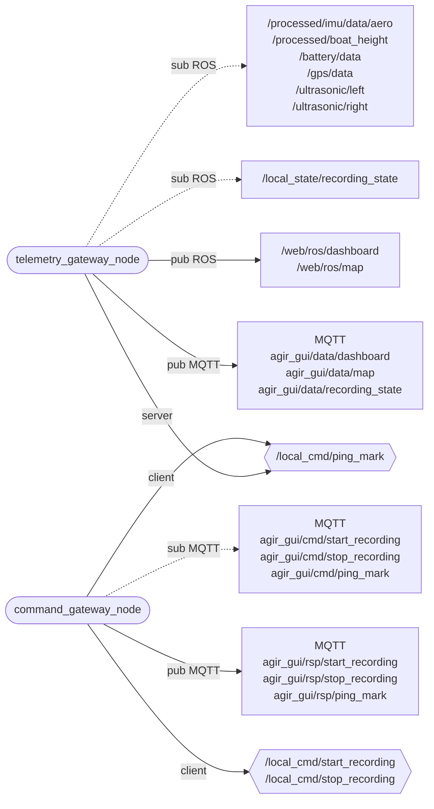

# communication_web — collegamento con la web app

_Aggiornato al giorno: 30/10/2026_

[English](README_ENG.md) · [Workspace](../../README.md)

## Introduzione

Questo pacchetto collega il sistema ROS alla web app attraverso MQTT. Riceve le misure già pubblicate dagli altri nodi, prepara dashboard e mappa e gestisce i comandi che arrivano dall'interfaccia.

Il lavoro è diviso tra due nodi: `telemetry_gateway_node` prepara e invia i dati; `command_gateway_node` riceve le richieste dell'utente e chiama i servizi ROS appropriati. Nessuno dei due legge direttamente un sensore.

## Struttura del pacchetto

```text
communication_web/
├── communication_web/
│   ├── gateway/          telemetry, orientation, MQTT client, recording/mark RPC
│   ├── generated/        ros_endpoints.py
│   ├── command_gateway_node.py
│   └── telemetry_gateway_node.py
├── config/               endpoints.yaml, params.yaml, mqtt_config.example.yaml
├── launch/
├── test/
├── package.xml
└── setup.py
```

I due file `*_node.py` collegano ROS alla logica contenuta in [gateway/](communication_web/gateway/). Qui `telemetry.py` conserva le misure e prepara i dati, `orientation.py` ricava gli angoli dal quaternione e `mqtt_client.py` gestisce Paho, TLS e riconnessione. `recording_rpc.py` e `mark_rpc.py` seguono richieste, risposte e timeout.

[params.yaml](config/params.yaml) contiene frequenze e limiti; [endpoints.yaml](config/endpoints.yaml) definisce i nomi ROS e MQTT. Il file privato `config/mqtt_config.yaml`, da preparare partendo dal [modello](config/mqtt_config.example.yaml), contiene la configurazione del broker per entrambi i gateway.

## Nodi e collegamenti

Gli ovali sono i due nodi del pacchetto; i rettangoli raccolgono topic ROS o MQTT e gli esagoni sono servizi ROS. `pub` e `sub` partono sempre dal nodo: la freccia tratteggiata indica il topic ascoltato. `client` indica chi chiama un servizio, `server` chi lo offre. I servizi start/stop sono offerti da `rosbag_manager`, esterno a questo diagramma.



## Come vengono preparati dashboard e mappa

Il telemetry gateway conserva l'ultimo dato di ogni ingresso. A ogni scadenza del timer costruisce una vista aggiornata della barca, senza riprodurre una coda di misure vecchie. Prima di usare un dato controlla sia il timestamp della misura sia quanto tempo è passato dalla ricezione.

Le soglie predefinite sono 0,5 s per assetto, altezza e ultrasuoni, 2 s per GPS e 3 s per batteria. Un dato recente deve anche superare i controlli specifici: per esempio il GPS deve avere un fix e coordinate utilizzabili, mentre l'IMU deve contenere un quaternione valido.

| Uscita ROS | Tipo | Uscita MQTT | Frequenza predefinita |
|---|---|---|---|
| `/web/ros/dashboard` | `sail_msgs/msg/DashboardDataMsg` | `agir_gui/data/dashboard` | 3 Hz |
| `/web/ros/map` | `sail_msgs/msg/MapDataMsg` | `agir_gui/data/map` | 3 Hz |
| Stato ricevuto da `/local_state/recording_state` | `sail_msgs/msg/RecordingState` | `agir_gui/data/recording_state` | 0,5 Hz |

Dashboard e mappa hanno timer indipendenti, regolati da `dashboard_publish_rate_hz` e `map_publish_rate_hz`. Pubblicare anche su ROS permette di vedere i risultati con `ros2 topic echo` e registrarli nelle bag.

L'header di dashboard e mappa indica quando è stata preparata l'uscita; la mappa conserva anche il timestamp originale del GPS in `gps_stamp`. I numeri non disponibili sono NaN nei messaggi ROS e `null` nel JSON MQTT. Un flag di validità falso indica un dato non utilizzabile, non uno zero misurato.

### Significato dei dati mostrati

Il gateway ricava roll, pitch e yaw dal quaternione aeronautico. Gli angoli sono in gradi; lo yaw è in [0,360), con zero al nord magnetico e crescita in senso orario. A pitch ±90° roll e yaw non sono separabili: il convertitore sceglie roll zero e lo yaw equivalente.

SOG è la velocità rispetto al suolo in m/s. Il COG GPS descrive la direzione del movimento e non sostituisce lo yaw. Le due distanze degli ultrasuoni rimangono grezze; `height_m` è invece l'altezza corretta ricevuta da `data_elaboration`.

Per la batteria, un allarme recente può essere valido anche se la tensione non è disponibile: in quel caso il relativo valore viene inviato come `null`.

### Stato della registrazione

Il manager pubblica lo stato ROS a 2 Hz e quando cambia. Il gateway lo inoltra a MQTT a **0,5 Hz**, secondo `recording_state_publish_rate_hz`. Se non riceve aggiornamenti per 1,5 s, smette di inoltrare lo stato memorizzato.

`RecordingState` non ha header: qui viene controllato il tempo monotono trascorso dalla ricezione. Le risposte ai comandi start/stop vengono invece inviate appena pronte, senza aspettare il timer dello stato.

## Come vengono eseguiti i comandi

Il thread MQTT accoda le richieste; il nodo ROS le esamina ogni 0,05 s con `process_rate_hz: 20.0`. Questo parametro regola l'elaborazione dei comandi, non una pubblicazione periodica su MQTT.

Ogni richiesta deve avere un `requestId`, che permette al chiamante di riconoscere la risposta. I comandi retained vengono ignorati. La coda predefinita contiene al massimo 32 richieste, il payload ha limite 4096 byte e vengono ricordate fino a 128 risposte per gestire i duplicati. Questa memoria si perde al riavvio.

| Topic di richiesta MQTT | Payload | Servizio ROS | Topic di risposta MQTT |
|---|---|---|---|
| `agir_gui/cmd/start_recording` | `{"requestId":"id-univoco"}` | `/local_cmd/start_recording` | `agir_gui/rsp/start_recording` |
| `agir_gui/cmd/stop_recording` | `{"requestId":"id-univoco"}` | `/local_cmd/stop_recording` | `agir_gui/rsp/stop_recording` |
| `agir_gui/cmd/ping_mark` | `{"requestId":"id-univoco","type":0}` | `/local_cmd/ping_mark` | `agir_gui/rsp/ping_mark` |

Le risposte contengono `requestId`, `success`, `error_message` e, secondo l'operazione, `bag_name` o `mark`. Il timeout predefinito del servizio è 15 s. Un timeout non annulla un servizio già in esecuzione: prima di riprovare una registrazione, controllane lo stato. I messaggi pubblicati dal gateway non sono retained.

### Ping delle boe

Il servizio `PingMark` è offerto dal telemetry gateway, che possiede il GPS corrente. La richiesta indica soltanto il tipo: **COMMITTEE=0, PIN=1, WINDWARD=2**. Le coordinate non arrivano dal browser.

Se il fix è recente e valido, il servizio salva posizione e header originale del GPS. Non richiede che sia disponibile anche la SOG. Si conserva una boa per tipo: un nuovo ping sostituisce solo quella dello stesso tipo, e i duplicati della richiesta non catturano una seconda posizione.

Le boe vengono inserite in `MapDataMsg.marks` e continuano a essere inviate anche quando il fix attuale manca. Restano in memoria fino alla sostituzione o al riavvio del telemetry gateway. Richieste malformate, tipi sconosciuti, GPS vecchio o servizio non disponibile producono una risposta di errore.

## Avvio e test

Prepara `mqtt_config.yaml` per entrambi i nodi, con hostname, porta TCP/TLS, credenziali e CA del broker. Usa il nome host, non l'URL WebSocket del browser.

Con ambiente ROS e workspace caricati:

```bash
ros2 launch communication_web live_communication.launch.py
```

Il live avvia entrambi i nodi; il replay avvia soltanto telemetria con tempo simulato. `communication_web_launch.py` è un alias del live. Per file esterni usa `communication_web_params_file` e `communication_web_mqtt_config_file`; le impostazioni si applicano all'avvio.

Da `/home/ros/ros2_ws`, esegui `bash scripts/test.sh communication_web`. I test simulano MQTT e verificano anche percorsi ROS e servizi. Quando cambi il contratto, aggiorna lo YAML degli endpoint, i messaggi coinvolti, la web app e i relativi test.