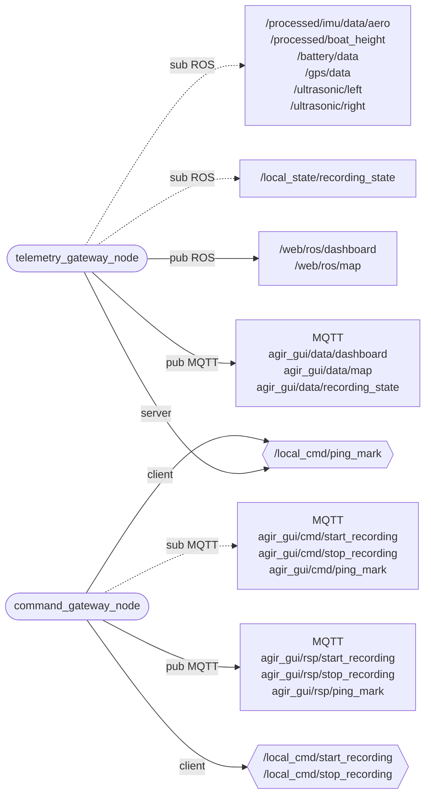

# communication_web — web app connection

_Updated on: 30/10/2026_

[Italiano](README.md) · [Workspace](../../README_ENG.md)

## Introduction

This package connects ROS to the web app through MQTT. It receives measurements published by other nodes, prepares dashboard and map data, and handles commands from the interface.

Two nodes divide the work: `telemetry_gateway_node` prepares and sends data; `command_gateway_node` receives user requests and calls the appropriate ROS services. Neither reads sensors directly.

## Package structure

```text
communication_web/
├── communication_web/
│   ├── gateway/          telemetry, orientation, MQTT client, recording/mark RPC
│   ├── generated/        ros_endpoints.py
│   ├── command_gateway_node.py
│   └── telemetry_gateway_node.py
├── config/               endpoints.yaml, params.yaml, mqtt_config.example.yaml
├── launch/
├── test/
├── package.xml
└── setup.py
```

The two `*_node.py` files connect ROS to logic in [gateway/](communication_web/gateway/). There, `telemetry.py` stores measurements and prepares output, `orientation.py` derives angles from quaternions, and `mqtt_client.py` handles Paho, TLS and reconnection. `recording_rpc.py` and `mark_rpc.py` track requests, responses and timeouts.

[params.yaml](config/params.yaml) contains rates and limits; [endpoints.yaml](config/endpoints.yaml) defines ROS and MQTT names. Private `config/mqtt_config.yaml`, prepared from the [template](config/mqtt_config.example.yaml), configures the broker for both gateways.

## Nodes and connections

Ovals are the package's two nodes; rectangles group ROS or MQTT topics and hexagons are ROS services. Both `pub` and `sub` arrows start at the node; dashed arrows identify subscribed topics. `client` identifies the caller and `server` the service provider. Start/stop services are provided by `rosbag_manager`, outside this diagram.



## Preparing dashboard and map data

The telemetry gateway keeps the latest sample for each input. Each timer tick builds an updated view of the boat rather than replaying a queue of old measurements. Before using a sample, it checks both the measurement timestamp and elapsed time since receipt.

Default thresholds are 0.5 s for attitude, height and ultrasound, 2 s for GPS and 3 s for battery. Recent data must also pass specific checks: GPS needs a usable fix and coordinates, and IMU needs a valid quaternion.

| ROS output | Type | MQTT output | Default rate |
|---|---|---|---|
| `/web/ros/dashboard` | `sail_msgs/msg/DashboardDataMsg` | `agir_gui/data/dashboard` | 3 Hz |
| `/web/ros/map` | `sail_msgs/msg/MapDataMsg` | `agir_gui/data/map` | 3 Hz |
| State received on `/local_state/recording_state` | `sail_msgs/msg/RecordingState` | `agir_gui/data/recording_state` | 0.5 Hz |

Dashboard and map use independent timers, configured by `dashboard_publish_rate_hz` and `map_publish_rate_hz`. ROS outputs make the same information available to `ros2 topic echo` and bag recording.

Dashboard and map headers indicate output preparation time; the map also retains the original GPS timestamp in `gps_stamp`. Unavailable numbers are NaN in ROS and `null` in MQTT JSON. A false validity flag means unavailable data, not a measured zero.

### Meaning of displayed data

The gateway derives roll, pitch and yaw from the aeronautical quaternion. Angles are degrees; yaw is in [0,360), zero at magnetic north and increasing clockwise. At pitch ±90°, roll and yaw cannot be separated; the converter chooses zero roll and equivalent yaw.

SOG is speed over ground in m/s. GPS COG describes motion direction and does not replace yaw. Ultrasonic distances remain raw; `height_m` is corrected height received from `data_elaboration`.

A recent battery alarm can be valid even without voltage, in which case voltage is sent as `null`.

### Recording state

The manager publishes ROS state at 2 Hz and on changes. The gateway forwards it to MQTT at **0.5 Hz**, controlled by `recording_state_publish_rate_hz`. After 1.5 s without updates, it stops forwarding cached state.

`RecordingState` has no header, so this check uses monotonic time since receipt. Start/stop responses are sent as soon as ready, independently of the state timer.

## Handling commands

The MQTT thread queues requests; the ROS node examines them every 0.05 s with `process_rate_hz: 20.0`. This controls command processing, not periodic MQTT publication.

Each request requires a `requestId` to correlate its response. Retained commands are ignored. Defaults allow 32 queued requests, 4096-byte payloads and 128 cached responses for duplicate handling. This memory is lost on restart.

| MQTT request topic | Payload | ROS service | MQTT response topic |
|---|---|---|---|
| `agir_gui/cmd/start_recording` | `{"requestId":"unique-id"}` | `/local_cmd/start_recording` | `agir_gui/rsp/start_recording` |
| `agir_gui/cmd/stop_recording` | `{"requestId":"unique-id"}` | `/local_cmd/stop_recording` | `agir_gui/rsp/stop_recording` |
| `agir_gui/cmd/ping_mark` | `{"requestId":"unique-id","type":0}` | `/local_cmd/ping_mark` | `agir_gui/rsp/ping_mark` |

Responses contain `requestId`, `success`, `error_message` and either `bag_name` or `mark`, depending on the operation. The service timeout defaults to 15 s. Timing out does not cancel an already running service: check recording state before retrying. Gateway publications are not retained.

### Buoy ping

The telemetry gateway provides `PingMark` because it owns the current GPS sample. Requests identify only a type: **COMMITTEE=0, PIN=1, WINDWARD=2**. Coordinates do not come from the browser.

With a fresh valid fix, the service saves the position and original GPS header. SOG is not required. One mark is kept per type: a new ping replaces only that type, and duplicate requests do not capture another position.

Marks are included in `MapDataMsg.marks` and continue to be sent even without a current fix. They remain in memory until replaced or the telemetry gateway restarts. Malformed requests, unknown types, stale GPS or unavailable services return errors.

## Startup and tests

Prepare `mqtt_config.yaml` for both nodes with the broker hostname, TCP/TLS port, credentials and CA. Use the hostname, not the browser's WebSocket URL.

With ROS and the workspace sourced:

```bash
ros2 launch communication_web live_communication.launch.py
```

Live starts both nodes; replay starts telemetry only with simulated time. `communication_web_launch.py` is a live alias. External files can be selected with `communication_web_params_file` and `communication_web_mqtt_config_file`; settings apply at startup.

From `/home/ros/ros2_ws`, run `bash scripts/test.sh communication_web`. Tests mock MQTT and also exercise ROS paths and services. Contract changes require updating endpoint YAML, affected messages, the web app and tests.