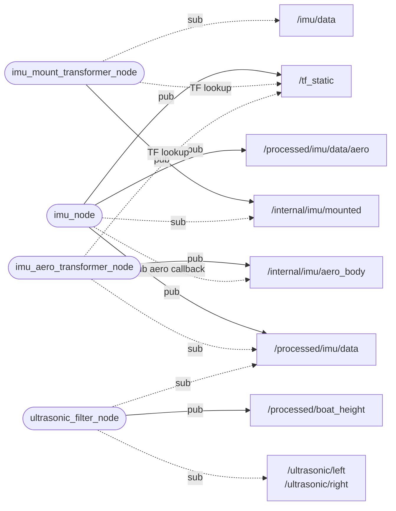

# data_elaboration — orientamento e altezza della barca

_Aggiornato al giorno: 30/10/2026_

[English](README_ENG.md) · [Workspace](../../README.md)

## Introduzione

Una misura corretta del sensore non è ancora necessariamente la misura che ci serve sulla barca. L'IMU può essere montata ruotata o lontano dal centro di massa; gli ultrasuoni possono essere inclinati e spostati rispetto al punto di cui vogliamo conoscere l'altezza.

Questo pacchetto tiene conto di questi montaggi. Riceve messaggi da ROS, corregge l'orientamento e l'accelerazione dell'IMU e combina assetto e distanze per stimare l'altezza della linea di galleggiamento. Non apre porte hardware: quelle appartengono a [sensors](../sensors/README.md).

## Struttura del pacchetto

```text
data_elaboration/
├── config/              params.yaml, endpoints.yaml
├── data_elaboration/
│   ├── generated/       ros_endpoints.py
│   ├── processing/      imu_frames.py, imu_filter.py, lever_arm.py, boat_height.py
│   ├── imu_node.py
│   └── ultrasonic_filter_node.py
├── launch/
├── test/
├── package.xml
└── setup.py
```

[params.yaml](config/params.yaml) raccoglie montaggi, frequenze e soglie. I nomi degli output sono in [endpoints.yaml](config/endpoints.yaml), mentre quelli degli input grezzi vengono dalle costanti generate di `sensors`. Le formule e le conversioni sono in `processing/`, separate dai nodi che ricevono e pubblicano messaggi.

## Nodi, topic e trasformazioni

Gli ovali sono nodi. Una freccia continua `pub` va dal nodo al topic pubblicato; una freccia tratteggiata `sub` va dal nodo al topic che ascolta. Le frecce di sottoscrizione indicano quindi la dipendenza, non il verso del dato.



Il percorso principale dell'IMU è: misura grezza, correzione del montaggio, elaborazione, conversione aeronautica. I due transformer sono istanze del pacchetto ROS esterno `imu_transformer`; `imu_node` pubblica le trasformazioni statiche che servono loro.

Il ritorno da `/internal/imu/aero_body` entra in una callback dedicata di `imu_node`. Non ripassa nel percorso robotico: il collegamento di ritorno nel diagramma non è un ciclo che rielabora indefinitamente la stessa misura.

| Interfacce | Tipo | Utilizzo |
|---|---|---|
| Tutti i topic IMU del diagramma | `sensor_msgs/msg/Imu` | Orientamento, velocità angolare, accelerazione e covarianze. |
| `/ultrasonic/left`, `/ultrasonic/right` | `sensor_msgs/msg/Range` | Distanze grezze dai due sensori. |
| `/processed/boat_height` | `marti_common_msgs/msg/Float64Stamped` | Altezza in metri nel campo `value`. |
| `/tf_static` | `tf2_msgs/msg/TFMessage` | Trasformazioni statiche usate dai transformer. |

## Come viene elaborata l'IMU

[imu_node.py](data_elaboration/imu_node.py) usa il quaternione già calcolato dal BNO085 quando il messaggio dichiara un orientamento disponibile (`orientation_covariance[0] != -1`). Lo controlla e lo normalizza, senza rifare la fusione dei sensori o una calibrazione statica.

Per input più vecchi, privi di orientamento, rimane un filtro complementare in [imu_filter.py](data_elaboration/processing/imu_filter.py). I parametri `calibration_samples` e `complementary_alpha` riguardano questo percorso, non il normale quaternione BNO085.

### Montaggio e convenzioni degli assi

`tf_offset=[x,y,z,roll,pitch,yaw]` descrive posizione e rotazione del sensore: metri per XYZ, gradi per gli angoli. Il riferimento della barca usa **FLU**: X verso prua, Y verso sinistra, Z verso l'alto.

L'output robotico combina assi barca FLU e riferimento mondo ENU. L'output aeronautico usa assi barca FRD e riferimento mondo NED. Sono due conversioni diverse: `tf_offset_aero=[0,0,0,180,0,0]` cambia gli assi della barca, mentre `world_rotation_rpy_deg=[180,0,90]` cambia il riferimento del mondo.

Con `rotation_vector` il riferimento al nord è magnetico. Qui non si corregge la declinazione e non si pubblicano messaggi roll/pitch/yaw separati: il [gateway](../communication_web/README.md) ricava quegli angoli dal quaternione aeronautico, portando lo yaw nell'intervallo [0,360).

### Compensazione del braccio

`base_link` identifica il centro di massa. I primi tre valori di `tf_offset` sono il vettore **dal centro di massa al sensore**, espresso negli assi FLU. Se il sensore è lontano dal centro, misura anche accelerazioni dovute alla rotazione della barca.

Dopo che il transformer ha ruotato i vettori, [lever_arm.py](data_elaboration/processing/lever_arm.py) sottrae questi contributi una sola volta:

```text
a_COM = a_sensore - alpha × r - omega × (omega × r)
alpha = (omega_attuale - omega_precedente) / dt
```

`omega` viene dal giroscopio e `dt` dai timestamp originali delle misure. Il timer di pubblicazione non viene usato per stimare questa derivata. La correzione conserva la gravità e non cambia il quaternione; con XYZ a zero non modifica l'accelerazione.

Con un braccio non nullo servono due campioni. Al primo campione, o dopo un intervallo superiore a `max_sample_dt_s`, il nodo aspetta il successivo prima di pubblicare l'accelerazione corretta. La derivata può amplificare il rumore del gyro, quindi la taratura va verificata con misure reali.

I frame di output hanno origine al centro di massa; la trasformazione del sensore conserva invece il montaggio fisico. La conversione aeronautica successiva cambia solo gli assi e non applica di nuovo la compensazione.

### Frequenza e freschezza

Ogni campione nuovo e utilizzabile viene elaborato appena arriva. Il timer pubblica l'ultimo risultato robotico a **50 Hz**, secondo `publish_rate_hz`; impostando zero si pubblica appena il risultato è pronto. Valori negativi o non finiti vengono rifiutati.

Le ripetizioni conservano il timestamp e smettono quando il risultato supera 0,5 s. Si controlla anche il tempo monotono per non mantenere valido un dato se l'orologio ROS si ferma. L'uscita aeronautica segue i nuovi campioni trasformati, senza un secondo timer; duplicati e timestamp fuori ordine vengono ignorati. Un salto indietro del clock svuota lo stato temporale.

Le covarianze originali sono mantenute salvo override positivo configurato. Per l'accelerazione compensata si usa `cov_acc` se positivo, altrimenti l'incertezza resta sconosciuta. Zero non significa errore nullo.

## Come viene stimata l'altezza

[ultrasonic_filter_node.py](data_elaboration/ultrasonic_filter_node.py) unisce le distanze con l'assetto della barca. Il punto di riferimento O è fissato sulla linea di galleggiamento di progetto, sotto il centro di massa. L'altezza indica la distanza verticale di O dal piano dell'acqua: positiva sopra, negativa sotto.

### Posizione e inclinazione degli ultrasuoni

Per ogni sensore si configura un unico array. Per esempio:

```yaml
left:
  mounting: [2.0, 0.2, 0.6, 15.0, 0.0]
```

I cinque elementi sono `[x_m,y_m,z_m,lateral_tilt_deg,forward_tilt_deg]`. Nell'esempio, il sensore si trova 2 m a prua, 20 cm a sinistra e 60 cm sopra O, con il fascio inclinato di 15° verso sinistra rispetto alla verticale verso il basso. Un'inclinazione avanti positiva punta a prua. Questi angoli descrivono il montaggio, non il campo visivo del sensore.

In [boat_height.py](data_elaboration/processing/boat_height.py), con R rotazione dagli assi della barca al mondo, r posizione del sensore, d distanza misurata, a inclinazione laterale e b inclinazione avanti:

```text
u = [sin(b), cos(b) sin(a), -cos(b) cos(a)]
c_i = -(R u_i)_z
h_i = -(R r_i)_z + d_i c_i
w_i = c_i ** incidence_weight_power
h = sum(w_i h_i) / sum(w_i)
```

Seni e coseni proiettano verticalmente il fascio e la posizione del sensore. Per questo non basta sommare un offset costante alla distanza. Un fascio troppo orizzontale, oltre il limite predefinito di 60°, non produce una stima.

### Scelta dei campioni e pubblicazione

Il nodo conserva una breve storia dell'IMU. Per ogni nuova distanza usa l'assetto più recente **precedente** alla misura, entro `max_attitude_age_s=0.1`. Non interpola né suppone la barca piatta se l'assetto manca. Controlla anche il frame `imu_link_flu`: non cerca automaticamente una trasformazione da un altro frame.

Le distanze devono avere meno di 0,5 s; i due lati vengono combinati solo entro `max_pair_dt_s=0.15`. Ogni lato conserva la propria correzione geometrica. Quando entrambi sono utilizzabili, il peso favorisce il fascio più verticale (potenza predefinita 8). Se le stime differiscono di oltre 0,25 m, viene scelta quella più verticale; a pari incidenza il conflitto impedisce la pubblicazione. È possibile produrre una stima anche con un solo lato valido.

Il calcolo segue l'arrivo delle distanze; l'IMU aggiorna soltanto la storia. Il timer pubblica a **20 Hz**, oppure subito al risultato con `publish_rate_hz: 0.0`. L'header conserva il timestamp della distanza che ha prodotto la stima. Prima di ripubblicare, il nodo ricontrolla la freschezza dei campioni coinvolti.

Il frame di output è `boat_waterline`, ma il nodo non crea automaticamente una TF per quel punto. Questa è una correzione geometrica: non è una media mobile e non elimina da sola onde, interferenze tra sensori o riflessioni.

## Avvio e verifica

Con ambiente ROS e workspace caricati nel container:

```bash
ros2 launch data_elaboration live_data_elaboration.launch.py
```

I launch live e replay avviano quattro processi: i due transformer, `imu_node` e `ultrasonic_filter_node`. Il replay imposta il tempo simulato. Per un altro file di configurazione usa `data_elaboration_params_file:=/percorso/params.yaml`.

Da `/home/ros/ros2_ws`, esegui `bash scripts/test.sh data_elaboration`. I test verificano frame, quaternioni, geometria, braccio e dati scaduti. Sulla barca confronta anche l'altezza con una misura indipendente a diversi roll e pitch: è il modo per verificare montaggio e soglie.