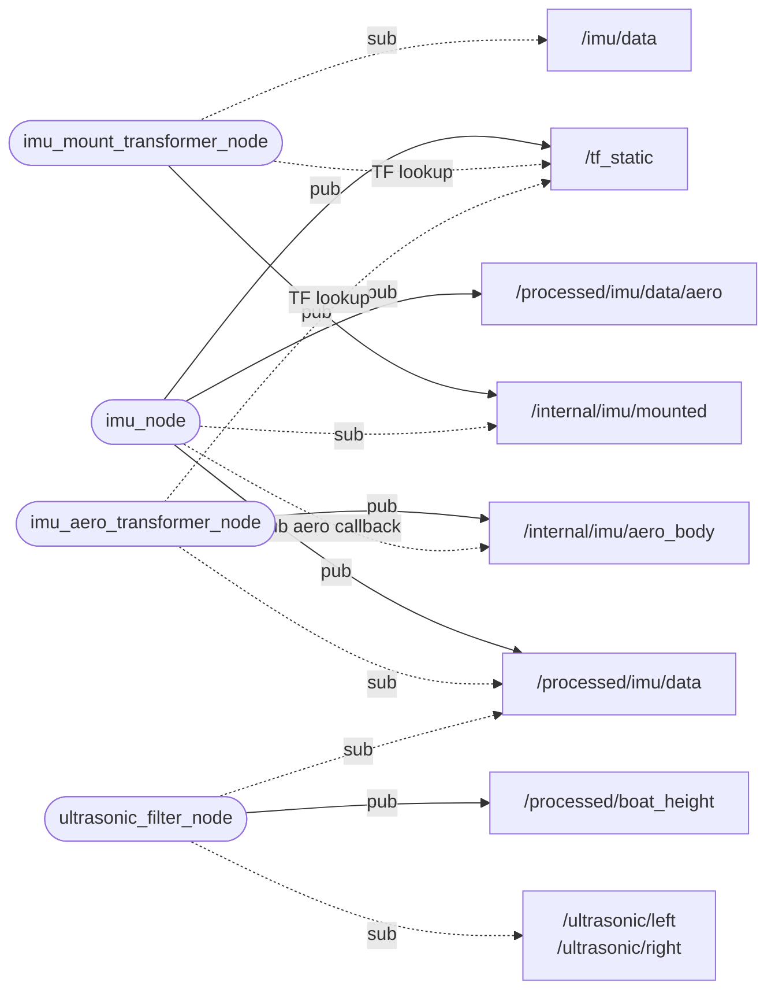

# data_elaboration — boat attitude and height

_Updated on: 30/10/2026_

[Italiano](README.md) · [Workspace](../../README_ENG.md)

## Introduction

A correct sensor measurement is not necessarily the quantity needed at the boat's reference point. The IMU may be rotated or mounted away from the centre of mass; ultrasonic sensors may be tilted and displaced from the point whose height we want.

This package accounts for that mounting geometry. It receives ROS messages, corrects IMU attitude and acceleration, and combines attitude with ranges to estimate waterline height. It does not open hardware ports; [sensors](../sensors/README_ENG.md) owns those.

## Package structure

```text
data_elaboration/
├── config/              params.yaml, endpoints.yaml
├── data_elaboration/
│   ├── generated/       ros_endpoints.py
│   ├── processing/      imu_frames.py, imu_filter.py, lever_arm.py, boat_height.py
│   ├── imu_node.py
│   └── ultrasonic_filter_node.py
├── launch/
├── test/
├── package.xml
└── setup.py
```

[params.yaml](config/params.yaml) contains mounting geometry, rates and thresholds. Output names live in [endpoints.yaml](config/endpoints.yaml); raw input names come from generated `sensors` constants. Formulae and conversions live in `processing/`, separately from the nodes receiving and publishing messages.

## Nodes, topics and transforms

Ovals are nodes. Solid `pub` arrows point from a node to its published topic; dashed `sub` arrows point from a node to the topic it subscribes to. Subscription arrows therefore show dependencies rather than data direction.



The main IMU path is raw measurement, mounting correction, processing, then aeronautical conversion. The two transformers are instances of the external ROS `imu_transformer` package; `imu_node` publishes their required static transforms.

The return from `/internal/imu/aero_body` enters a dedicated `imu_node` callback. It does not re-enter the robotic processing path: the return edge is not an endless measurement-processing loop.

| Interfaces | Type | Use |
|---|---|---|
| All IMU topics shown | `sensor_msgs/msg/Imu` | Orientation, angular velocity, acceleration and covariances. |
| `/ultrasonic/left`, `/ultrasonic/right` | `sensor_msgs/msg/Range` | Raw sensor distances. |
| `/processed/boat_height` | `marti_common_msgs/msg/Float64Stamped` | Height in metres in `value`. |
| `/tf_static` | `tf2_msgs/msg/TFMessage` | Static transforms used by the transformers. |

## IMU processing

[imu_node.py](data_elaboration/imu_node.py) uses the BNO085 quaternion when the message declares an available orientation (`orientation_covariance[0] != -1`). It validates and normalizes it without repeating sensor fusion or static calibration.

A complementary filter remains in [imu_filter.py](data_elaboration/processing/imu_filter.py) for older inputs without orientation. `calibration_samples` and `complementary_alpha` apply to that path, not the normal BNO085 quaternion.

### Mounting and axis conventions

`tf_offset=[x,y,z,roll,pitch,yaw]` describes sensor position and rotation: metres for XYZ and degrees for angles. Boat axes use **FLU**: X forward, Y left, Z up.

Robotic output combines FLU body axes with ENU world axes. Aeronautical output uses FRD body axes and NED world axes. These are separate conversions: `tf_offset_aero=[0,0,0,180,0,0]` changes the body axes, while `world_rotation_rpy_deg=[180,0,90]` changes the world reference.

With `rotation_vector`, north is magnetic. This package does not correct declination or publish a separate roll/pitch/yaw message. The [gateway](../communication_web/README_ENG.md) derives those angles from the aeronautical quaternion and wraps yaw into [0,360).

### Lever-arm compensation

`base_link` identifies the centre of mass. The first three `tf_offset` values are the vector **from the centre of mass to the sensor**, expressed in FLU. A displaced sensor also measures acceleration caused by boat rotation.

After the transformer rotates vectors, [lever_arm.py](data_elaboration/processing/lever_arm.py) subtracts these contributions once:

```text
a_COM = a_sensor - alpha × r - omega × (omega × r)
alpha = (omega_current - omega_previous) / dt
```

`omega` comes from the gyro and `dt` from original measurement timestamps, not the publication timer. The correction retains gravity and leaves the quaternion unchanged; zero XYZ leaves acceleration unchanged.

A nonzero lever arm requires two samples. At the first sample, or after a gap exceeding `max_sample_dt_s`, the node waits for the next one before publishing corrected acceleration. Differentiation can amplify gyro noise, so tuning needs real measurements.

Output frames originate at the centre of mass; the sensor transform retains the physical mounting. Subsequent aeronautical conversion only changes axes and does not apply compensation again.

### Rate and freshness

Each new usable sample is processed on arrival. The timer publishes the latest robotic result at **50 Hz**, controlled by `publish_rate_hz`; zero publishes as soon as a result is ready. Negative or nonfinite rates are rejected.

Repeated publication retains the timestamp and stops after the result exceeds 0.5 s. Monotonic time is also checked so a paused ROS clock cannot keep data fresh indefinitely. Aeronautical output follows new transformed samples without a second timer; duplicates and out-of-order timestamps are ignored. A backward clock jump clears temporal state.

Original covariances are retained unless a positive override is configured. Corrected acceleration uses positive `cov_acc`, otherwise uncertainty is unknown. Zero does not mean zero error.

## Height estimation

[ultrasonic_filter_node.py](data_elaboration/ultrasonic_filter_node.py) combines distances with boat attitude. Reference point O is fixed on the design waterline below the centre of mass. Height is O's vertical distance from the water plane: positive above it and negative below.

### Ultrasonic position and tilt

Each sensor has one mounting array, for example:

```yaml
left:
  mounting: [2.0, 0.2, 0.6, 15.0, 0.0]
```

The entries are `[x_m,y_m,z_m,lateral_tilt_deg,forward_tilt_deg]`. This example places the sensor 2 m forward, 20 cm left and 60 cm above O, with its beam tilted 15° left from downward vertical. Positive forward tilt points towards the bow. These angles describe mounting, not sensor field of view.

In [boat_height.py](data_elaboration/processing/boat_height.py), R rotates body into world axes, r is sensor position, d measured distance, a lateral tilt and b forward tilt:

```text
u = [sin(b), cos(b) sin(a), -cos(b) cos(a)]
c_i = -(R u_i)_z
h_i = -(R r_i)_z + d_i c_i
w_i = c_i ** incidence_weight_power
h = sum(w_i h_i) / sum(w_i)
```

Sines and cosines project the beam and sensor position vertically. Adding a constant offset to measured distance is therefore insufficient. A beam beyond the default 60° incidence limit does not produce an estimate.

### Sample selection and publication

The node keeps a short IMU history. Each new range uses the latest **preceding** attitude within `max_attitude_age_s=0.1`. It does not interpolate or assume a level boat if attitude is missing. It also checks the `imu_link_flu` frame rather than automatically transforming other frames.

Ranges must be younger than 0.5 s; the two sides are combined only within `max_pair_dt_s=0.15`. Each side retains its own geometric correction. When both are usable, weighting favours the more vertical beam (default power 8). If estimates differ by more than 0.25 m, the more vertical one wins; equal-incidence conflict suppresses publication. One valid side can also produce an estimate.

Computation follows range arrivals; IMU messages only update history. The timer publishes at **20 Hz**, or immediately on a result with `publish_rate_hz: 0.0`. The header retains the timestamp of the triggering range. Before republishing, the node rechecks freshness of the samples used.

Output frame `boat_waterline` identifies the reference point, but the node does not create its TF automatically. This is geometric correction, not a moving average; it does not by itself eliminate waves, sensor interference or reflections.

## Startup and verification

With ROS and the workspace sourced inside the container:

```bash
ros2 launch data_elaboration live_data_elaboration.launch.py
```

Live and replay launch four processes: two transformers, `imu_node` and `ultrasonic_filter_node`. Replay enables simulated time. Override configuration with `data_elaboration_params_file:=/path/to/params.yaml`.

From `/home/ros/ros2_ws`, run `bash scripts/test.sh data_elaboration`. Tests cover frames, quaternions, geometry, lever arms and stale data. On the boat, also compare height against an independent measurement at different roll and pitch angles to check mounting and thresholds.