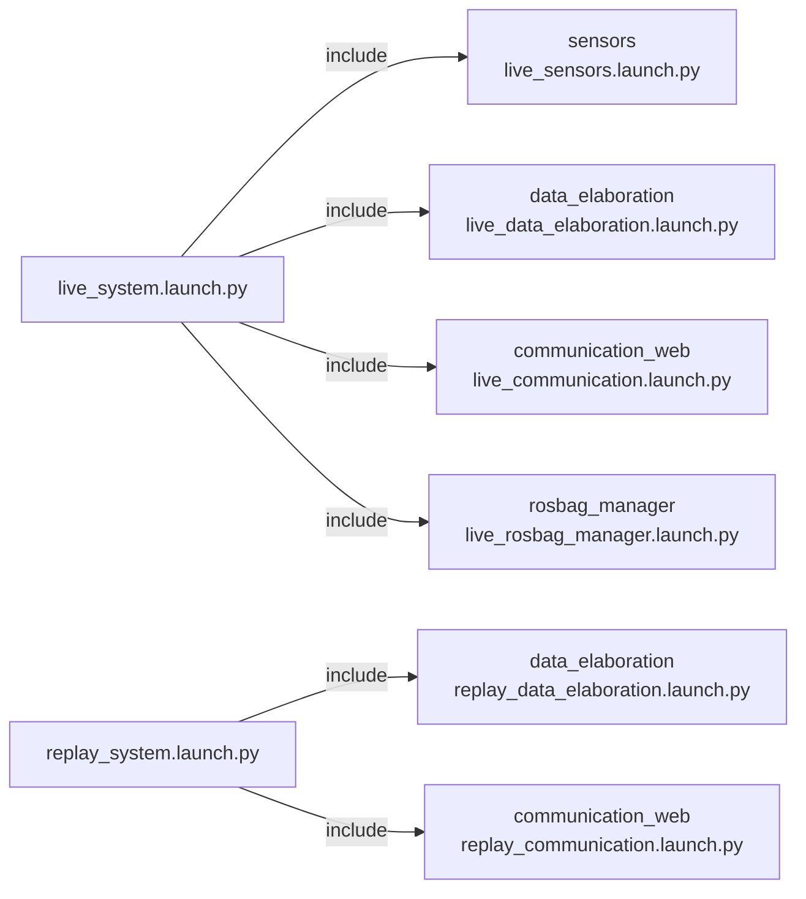

# orchestrator — avvio del sistema

_Aggiornato al giorno: 30/10/2026_

[English](README_ENG.md) · [Workspace](../../README.md)

## Introduzione

Per usare la barca non vogliamo avviare a mano ogni nodo e ricordare tutti i suoi parametri. `orchestrator` raccoglie i launch dei pacchetti in due punti di ingresso: uno per il sistema live, uno per rielaborare una registrazione.

Questo pacchetto non esegue un nodo ROS e non pubblica o ascolta topic. Decide quali componenti avviare; i dati continuano a passare direttamente tra i nodi dei rispettivi pacchetti.

## Struttura del pacchetto

```text
orchestrator/
├── launch/
│   ├── live_system.launch.py
│   └── replay_system.launch.py
├── orchestrator/       __init__.py
├── package.xml
└── setup.py
```

[package.xml](package.xml) dichiara le dipendenze, mentre `setup.py` installa i launch. I parametri dei sensori e dei gateway rimangono nei loro pacchetti.

## Come vengono avviati i componenti

Le frecce del diagramma indicano l'inclusione di un launch, non topic o servizi.



Il live avvia acquisizione, elaborazione, entrambi i gateway e il manager delle registrazioni. La registrazione inizia solo su richiesta.

Il replay avvia elaborazione e il solo telemetry gateway, con `use_sim_time=true`. Non avvia sensori, command gateway o rosbag manager. Anche il processo `ros2 bag play` va avviato separatamente: il launch prepara i consumatori, ma non sceglie quale bag riprodurre.

## Avvio live

Nel container, con il workspace compilato:

```bash
cd /home/ros/ros2_ws
bash scripts/run.sh live
```

Lo script carica ROS e `install/setup.bash` prima di avviare il launch. Se hai già caricato l'ambiente, puoi usare direttamente `ros2 launch orchestrator live_system.launch.py`.

Sul Raspberry, per il normale avvio completo dall'host usa invece [DAY_BEFORE_REGATTA/run.sh](../../../DAY_BEFORE_REGATTA/run.sh), che avvia anche il container. Non sono due sistemi diversi: il comando sull'host richiama quello nel workspace.

## Replay di una registrazione

Nel primo terminale del container, dalla root del workspace:

```bash
bash scripts/run.sh replay
```

Nel secondo terminale del container:

```bash
source /opt/ros/jazzy/setup.bash
source /home/ros/ros2_ws/install/setup.bash
ros2 bag play /percorso/bag --clock --topics /imu/data /imu/mag /gps/data /ultrasonic/left /ultrasonic/right /compass/data /battery/data
```

Sostituisci `/percorso/bag` con la directory da analizzare. La selezione riproduce solo gli input: i nodi ricalcolano gli output, evitando di mescolarli a quelli già registrati. `--clock` fornisce il tempo simulato; senza la riproduzione della bag il launch, da solo, non genera misure.

Il telemetry gateway può inviare il replay al broker configurato. Prepara quindi anche il suo file MQTT e non eseguire contemporaneamente un live sugli stessi topic.

## Configurazione e modifiche

I launch inclusi espongono gli argomenti `sensors_params_file`, `data_elaboration_params_file`, `communication_web_params_file` e `communication_web_mqtt_config_file`. Per vedere quelli disponibili nell'installazione corrente:

```bash
ros2 launch orchestrator live_system.launch.py --show-args
```

Quando aggiungi un componente, dichiara la dipendenza in `package.xml` e includi il suo launch nella modalità corretta. Chiediti anche se debba partire in replay: un nodo che legge hardware o esegue comandi non va aggiunto automaticamente a entrambe le modalità.

I controlli di composizione live/replay si trovano anche nei [test di data_elaboration](../data_elaboration/test/test_replay_launch.py). Per build e verifiche consulta gli [script del workspace](../../scripts/README.md).