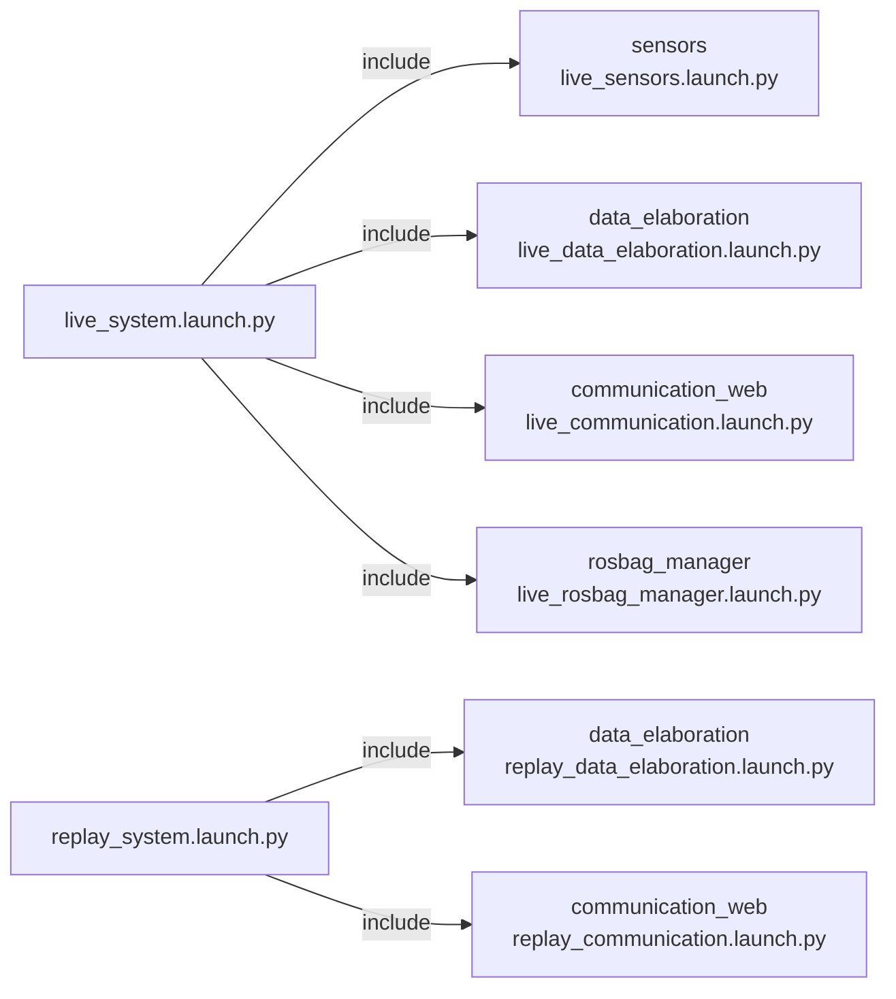

# orchestrator — system startup

_Updated on: 30/10/2026_

[Italiano](README.md) · [Workspace](../../README_ENG.md)

## Introduction

Operating the boat should not require starting every node manually and remembering all its parameters. `orchestrator` combines package launch files into two entry points: live operation and processing a recording again.

It does not run a ROS node or publish or subscribe to topics. It selects components to start; data continues to pass directly between their nodes.

## Package structure

```text
orchestrator/
├── launch/
│   ├── live_system.launch.py
│   └── replay_system.launch.py
├── orchestrator/       __init__.py
├── package.xml
└── setup.py
```

[package.xml](package.xml) declares dependencies and `setup.py` installs launch files. Sensor and gateway parameters remain in their own packages.

## Component startup

Diagram arrows mean launch inclusion, not topics or services.



Live starts acquisition, processing, both gateways and the recording manager. Recording starts only on request.

Replay starts processing and the telemetry gateway only, with `use_sim_time=true`. It excludes sensors, the command gateway and the recording manager. Start `ros2 bag play` separately: the launch prepares consumers but does not choose a bag to play.

## Live startup

Inside the container, with the workspace built:

```bash
cd /home/ros/ros2_ws
bash scripts/run.sh live
```

The script sources ROS and `install/setup.bash` before launching. With an already sourced environment, use `ros2 launch orchestrator live_system.launch.py` directly.

For normal Raspberry startup from the host, use [DAY_BEFORE_REGATTA/run.sh](../../../DAY_BEFORE_REGATTA/run.sh), which also starts the container. These are not separate systems: the host command invokes the workspace command.

## Replaying a recording

In the first container terminal, from the workspace root:

```bash
bash scripts/run.sh replay
```

In the second container terminal:

```bash
source /opt/ros/jazzy/setup.bash
source /home/ros/ros2_ws/install/setup.bash
ros2 bag play /path/to/bag --clock --topics /imu/data /imu/mag /gps/data /ultrasonic/left /ultrasonic/right /compass/data /battery/data
```

Replace `/path/to/bag` with the recording directory. Only inputs are replayed; nodes recalculate outputs rather than mixing them with recorded outputs. `--clock` supplies simulated time; the launch alone does not generate measurements.

The telemetry gateway may send replay data to its configured broker. Prepare its MQTT file too, and do not simultaneously run a live system on the same topics.

## Configuration and changes

Included launches expose `sensors_params_file`, `data_elaboration_params_file`, `communication_web_params_file` and `communication_web_mqtt_config_file`. Inspect arguments in the current installation with:

```bash
ros2 launch orchestrator live_system.launch.py --show-args
```

When adding a component, declare its dependency in `package.xml` and include its launch in the appropriate mode. Also decide whether it belongs in replay: hardware acquisition or command execution should not automatically be added to both modes.

Live/replay composition checks are also covered by [data_elaboration tests](../data_elaboration/test/test_replay_launch.py). See the [workspace scripts](../../scripts/README_ENG.md) for build and verification.