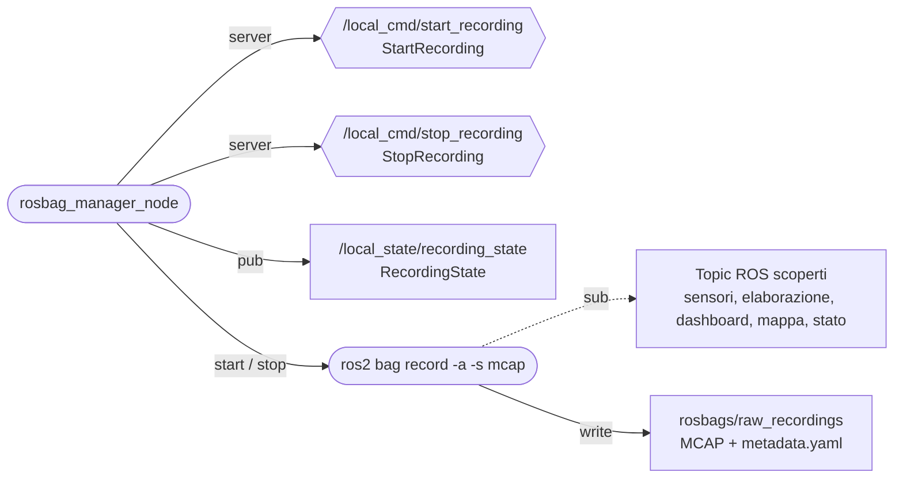

# rosbag_manager — registrare le prove

_Aggiornato al giorno: 30/10/2026_

[English](README_ENG.md) · [Workspace](../../README.md)

## Introduzione

Una rosbag conserva i messaggi ROS di una sessione, così possiamo analizzarli dopo una prova o riprodurli senza collegare i sensori. Questo pacchetto permette di avviare e fermare la registrazione dalla web app o da un comando ROS.

Il nodo `rosbag_manager_node` controlla un processo `ros2 bag record -a -s mcap`. È importante distinguere i due ruoli: il manager riceve i comandi e pubblica lo stato; il processo recorder si sottoscrive ai topic e scrive i file. Avviare il manager non avvia automaticamente una registrazione.

## Struttura del pacchetto

```text
rosbag_manager/
├── config/                    params.yaml, endpoints.yaml
├── launch/                    live_rosbag_manager.launch.py
├── rosbag_manager/
│   ├── generated/             ros_endpoints.py
│   ├── config_rosbag_manager.py
│   └── rosbag_manager_node.py
├── test/
├── package.xml
└── setup.py
```

[rosbag_manager_node.py](rosbag_manager/rosbag_manager_node.py) contiene il comportamento attuale. [params.yaml](config/params.yaml) configura destinazione, frequenze e timeout; [endpoints.yaml](config/endpoints.yaml) definisce servizi e topic. `config_rosbag_manager.py` è un file legacy e non configura il nodo attuale.

## Nodo, servizi e topic

Gli ovali indicano il nodo e il processo che avvia; gli esagoni sono i servizi offerti. La freccia `pub` va dal manager al suo topic; la freccia tratteggiata `sub` va dal recorder ai topic registrati.



| Interfaccia | Tipo in sail_msgs | Risultato |
|---|---|---|
| `/local_cmd/start_recording` | `srv/StartRecording` | Avvia la registrazione e restituisce successo, errore e nome effettivo della bag. |
| `/local_cmd/stop_recording` | `srv/StopRecording` | Ferma il recorder e restituisce successo, errore e nome dell'ultima bag. |
| `/local_state/recording_state` | `msg/RecordingState` | Indica se si sta registrando, il nome della bag e l'ultimo errore. |

Entrambi i servizi hanno richiesta vuota. `RecordingState` non ha header: chi lo riceve deve controllare da quanto tempo non arriva un aggiornamento.

## Cosa viene registrato

L'opzione `-a` registra tutti i topic ROS normali scoperti dal recorder, compresi quelli che compaiono dopo l'avvio. I topic nascosti non vengono inclusi automaticamente. MQTT non viene registrato direttamente, ma le copie ROS di dashboard e mappa permettono di conservare anche quei dati, comprese le boe.

La destinazione predefinita è `/home/ros/ros2_ws/rosbags/raw_recordings`, con prefisso `rosbag2_`. Il parametro `record_dir` permette di scegliere un'altra cartella. Nei Compose del progetto la cartella delle bag è condivisa con l'host, quindi le registrazioni rimangono disponibili anche ricreando il container.

Il manager non esporta CSV: per quello usa [allbags_to_csv.py](../../tools/README.md). Non è previsto un caricamento automatico delle registrazioni su un servizio cloud.

## Frequenze e chiusura della registrazione

Il nodo controlla il processo a **2 Hz**, tramite `process_check_rate_hz`, e pubblica lo stato a **2 Hz**, tramite `publish_rate_hz`. Start, stop e uscite inattese del recorder producono anche un aggiornamento immediato. Queste frequenze non cambiano la frequenza di misura dei sensori.

Quando riceve stop, il manager chiede al recorder di chiudere e attende, con `sigint_timeout: 5.0`. Durante questa attesa i timer del nodo possono essere ritardati. Per questo lo stato ricevuto dalla web app e la risposta allo stop sono due informazioni distinte: il [gateway](../communication_web/README.md) inoltra periodicamente lo stato a 0,5 Hz, mentre invia la risposta appena disponibile.

## Avvio e prova manuale

Il launch live del sistema avvia già il manager; il replay lo esclude. Per provarlo da solo, nel container con ROS e workspace caricati:

```bash
ros2 launch rosbag_manager live_rosbag_manager.launch.py
```

Con il sistema live avviato, da un altro terminale del container:

```bash
ros2 service call /local_cmd/start_recording sail_msgs/srv/StartRecording '{}'
ros2 topic echo /local_state/recording_state
```

`Ctrl+C` interrompe soltanto l'echo. Per terminare la registrazione e verificarla:

```bash
ros2 service call /local_cmd/stop_recording sail_msgs/srv/StopRecording '{}'
ls /home/ros/ros2_ws/rosbags/raw_recordings
ros2 bag info /home/ros/ros2_ws/rosbags/raw_recordings/BAG_DIRECTORY
```

Sostituisci `BAG_DIRECTORY` con il nome restituito dal servizio. Una risposta start positiva indica che il recorder è stato avviato, ma non dimostra che abbia già scoperto tutti i topic: controlla il contenuto dopo lo stop. Prima di prove lunghe verifica lo spazio con `df -h` e recupera la cartella completa della bag seguendo la [guida SSH](../../../guides/italiano/connessione_raspberry.md).

Da `/home/ros/ros2_ws`, i test si eseguono con `bash scripts/test.sh rosbag_manager`.
