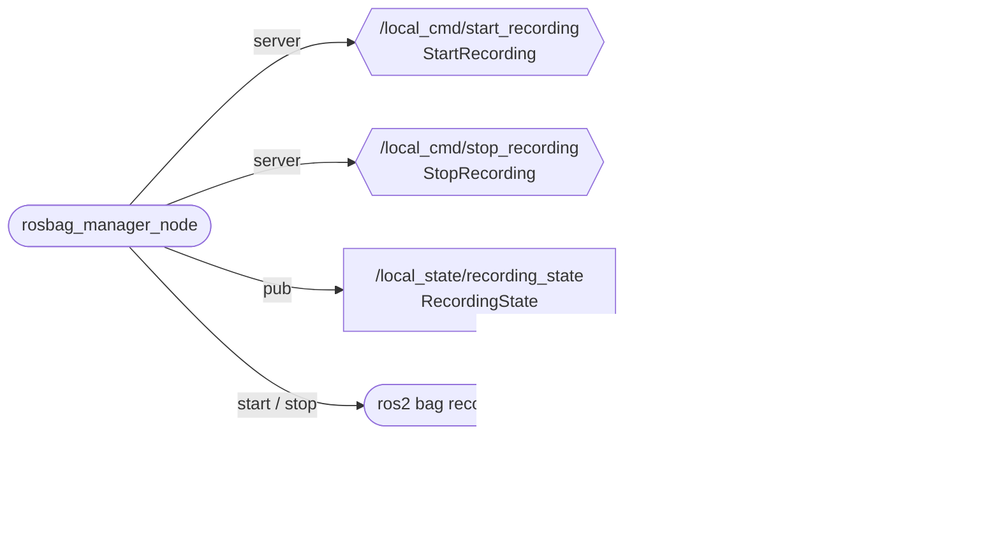

# rosbag_manager — recording tests

_Updated on: 30/10/2026_

[Italiano](README.md) · [Workspace](../../README_ENG.md)

## Introduction

A rosbag preserves a session's ROS messages for later analysis or replay without sensors. This package lets the web app or a ROS command start and stop recording.

`rosbag_manager_node` controls a `ros2 bag record -a -s mcap` process. Their roles differ: the manager accepts commands and publishes state; the recorder subscribes to topics and writes files. Starting the manager does not automatically start recording.

## Package structure

```text
rosbag_manager/
├── config/                    params.yaml, endpoints.yaml
├── launch/                    live_rosbag_manager.launch.py
├── rosbag_manager/
│   ├── generated/             ros_endpoints.py
│   ├── config_rosbag_manager.py
│   └── rosbag_manager_node.py
├── test/
├── package.xml
└── setup.py
```

[rosbag_manager_node.py](rosbag_manager/rosbag_manager_node.py) implements current behaviour. [params.yaml](config/params.yaml) configures destination, rates and timeouts; [endpoints.yaml](config/endpoints.yaml) defines services and topics. `config_rosbag_manager.py` is legacy and does not configure the current node.

## Node, services and topics

Ovals represent the node and its child process; hexagons are provided services. The `pub` arrow points from the manager to its topic; the dashed `sub` arrow points from the recorder to recorded topics.



| Interface | Type in sail_msgs | Result |
|---|---|---|
| `/local_cmd/start_recording` | `srv/StartRecording` | Starts recording and returns success, error and effective bag name. |
| `/local_cmd/stop_recording` | `srv/StopRecording` | Stops the recorder and returns success, error and last bag name. |
| `/local_state/recording_state` | `msg/RecordingState` | Reports whether recording, the bag name and the last error. |

Both services have empty requests. `RecordingState` has no header, so consumers must check elapsed time since the last update.

## What gets recorded

`-a` records all normal ROS topics discovered by the recorder, including topics appearing after startup. Hidden topics are not included automatically. MQTT is not recorded directly, but ROS dashboard and map copies preserve that information, including marks.

The default destination is `/home/ros/ros2_ws/rosbags/raw_recordings`, with prefix `rosbag2_`. Set `record_dir` to choose another directory. Project Compose configurations share the bag directory with the host, so recordings survive container recreation.

The manager does not export CSV; use [allbags_to_csv.py](../../tools/README_ENG.md) for that. Automatic cloud upload is not implemented.

## Rates and recording shutdown

The node checks the process at **2 Hz** through `process_check_rate_hz` and publishes state at **2 Hz** through `publish_rate_hz`. Start, stop and unexpected recorder exits also publish immediate updates. These rates do not change sensor measurement rates.

On stop, the manager asks the recorder to close and waits, with `sigint_timeout: 5.0`. Its timers can be delayed during that wait. Web app state and the stop response are therefore distinct: the [gateway](../communication_web/README_ENG.md) forwards state periodically at 0.5 Hz and sends the response as soon as available.

## Startup and manual checks

System live launch already starts the manager; replay excludes it. To run it alone, inside the container with ROS and the workspace sourced:

```bash
ros2 launch rosbag_manager live_rosbag_manager.launch.py
```

With the live system running, use another container terminal:

```bash
ros2 service call /local_cmd/start_recording sail_msgs/srv/StartRecording '{}'
ros2 topic echo /local_state/recording_state
```

`Ctrl+C` only stops echo. To finish recording and inspect the bag:

```bash
ros2 service call /local_cmd/stop_recording sail_msgs/srv/StopRecording '{}'
ls /home/ros/ros2_ws/rosbags/raw_recordings
ros2 bag info /home/ros/ros2_ws/rosbags/raw_recordings/BAG_DIRECTORY
```

Replace `BAG_DIRECTORY` with the returned name. A successful start response means the recorder started, not that every topic has already been discovered; inspect content after stopping. Before long tests, check space with `df -h` and retrieve the entire bag directory using the [SSH guide](../../../guides/inglese/raspberry_connection.md).

From `/home/ros/ros2_ws`, run tests with `bash scripts/test.sh rosbag_manager`.