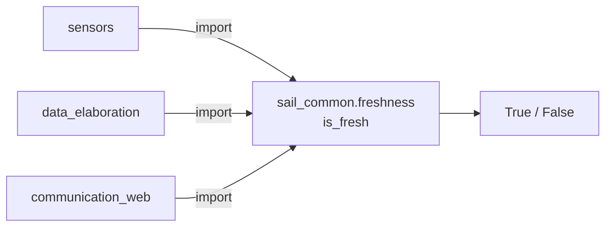

# sail_common — funzioni usate da più pacchetti

_Aggiornato al giorno: 30/10/2026_

[English](README_ENG.md) · [Workspace](../../README.md)

## Introduzione

Un nodo può aver ricevuto una misura corretta che, dopo qualche secondo senza aggiornamenti, non descrive più la situazione attuale. `sail_common` raccoglie il controllo condiviso per riconoscere questo caso, evitando che ogni nodo calcoli l'età dei dati in modo diverso.

È una libreria Python, non un nodo ROS: non ha topic, servizi o frequenze di pubblicazione. Attualmente contiene la funzione `is_fresh`; le soglie restano nei file YAML dei pacchetti che la usano.

## Struttura del pacchetto

```text
sail_common/
├── sail_common/
│   ├── __init__.py
│   └── freshness.py
├── test/
├── package.xml
└── setup.py
```

La logica si trova in [freshness.py](sail_common/freshness.py). I test verificano tempi ROS, valori numerici e casi limite.

## Come viene usato

Le frecce mostrano l'importazione della funzione, non uno scambio di topic. Il controllo viene eseguito nello stesso processo del nodo chiamante.



Esempio in una callback o prima di ripubblicare un dato:

```python
from sail_common.freshness import is_fresh

usable = is_fresh(
    msg.header.stamp,
    node.get_clock().now(),
    max_age_s,
)
```

Il risultato indica soltanto se la misura è abbastanza recente. Un fix GPS senza posizione o una distanza fuori campo possono essere recenti ma inutilizzabili: quei controlli rimangono nel nodo.

## Quale controllo viene fatto

La funzione restituisce vero quando:

```text
0 <= tempo_attuale - timestamp_misura <= max_age_s
```

Il limite è incluso. Timestamp mancanti, malformati, futuri o non finiti danno falso. Una soglia non positiva o non finita genera invece `ValueError`, perché indica una configurazione errata.

Sono accettati `builtin_interfaces/msg/Time`, `rclpy.time.Time` e valori numerici in **secondi**. Gli interi in nanosecondi non vanno passati come numeri di secondi. Per i tempi ROS si mantiene la precisione intera in nanosecondi.

I due istanti devono appartenere allo stesso orologio e alla stessa epoca. Non confrontare direttamente `time.monotonic()` con un header ROS: per rilevare anche un clock ROS fermo, il nodo deve effettuare due controlli distinti, ciascuno nel proprio dominio. Se due oggetti `rclpy.time.Time` dichiarano clock diversi, il controllo restituisce falso.

Lo zero è un tempo valido, per esempio all'inizio di una simulazione. Per rappresentare una misura mai ricevuta usa `None` o una cache vuota.

## Cosa deve fare il nodo chiamante

La funzione non imposta un timer, non cancella la misura e non programma la sua scadenza. Il nodo deve richiamarla quando usa o ripubblica il dato, e decidere cosa fare se non è più fresco. Se mantiene una storia di campioni, deve anche gestire i salti indietro dell'orologio.

Un messaggio con `stamp` diretto può passare quel campo alla stessa funzione. `Header` aggiunge il `frame_id` al timestamp, ma il controllo non usa il frame. Per messaggi senza timestamp, come `RecordingState`, il gateway controlla invece il tempo trascorso dalla ricezione.

Quando aggiungi un utilizzatore, dichiara `sail_common` in `package.xml` e verifica almeno dato assente, vecchio, futuro e al limite ammesso. Da `/home/ros/ros2_ws`, esegui `bash scripts/test.sh sail_common`.