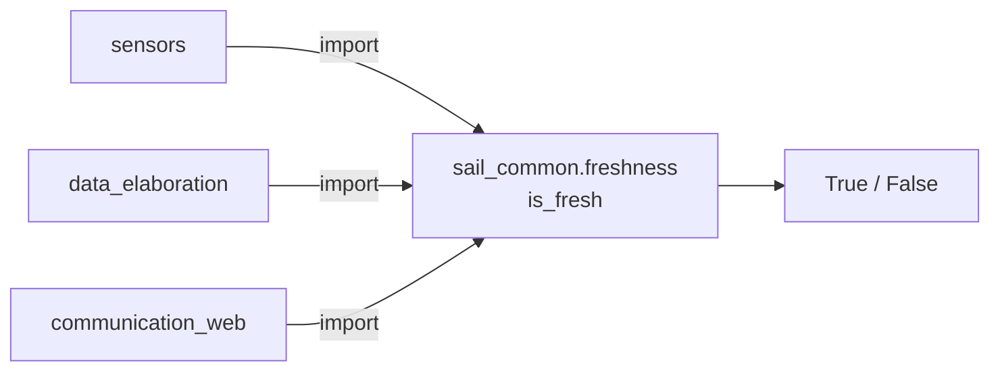

# sail_common — functions used by multiple packages

_Updated on: 30/10/2026_

[Italiano](README.md) · [Workspace](../../README_ENG.md)

## Introduction

A node may receive a correct measurement that no longer describes the current situation after several seconds without updates. `sail_common` provides a shared check for that condition, avoiding different age calculations in every node.

This is a Python library, not a ROS node: it has no topics, services or publication rates. It currently provides `is_fresh`; thresholds stay in the calling packages' YAML files.

## Package structure

```text
sail_common/
├── sail_common/
│   ├── __init__.py
│   └── freshness.py
├── test/
├── package.xml
└── setup.py
```

Implementation lives in [freshness.py](sail_common/freshness.py). Tests cover ROS times, numeric values and boundary cases.

## How it is used

Arrows show function imports, not topic exchanges. The check runs within the calling node's process.



Example in a callback or before republishing cached data:

```python
from sail_common.freshness import is_fresh

usable = is_fresh(
    msg.header.stamp,
    node.get_clock().now(),
    max_age_s,
)
```

The result only indicates whether a measurement is recent enough. A GPS fix without a position or an out-of-range distance can be recent but unusable; those checks remain in the node.

## What gets checked

The function returns true when:

```text
0 <= current_time - measurement_timestamp <= max_age_s
```

The upper boundary is included. Missing, malformed, future or nonfinite timestamps return false. Nonpositive or nonfinite thresholds raise `ValueError`, because they indicate invalid configuration.

Accepted inputs are `builtin_interfaces/msg/Time`, `rclpy.time.Time` and numeric **seconds**. Do not pass integer nanoseconds as numeric seconds. ROS times retain integer nanosecond precision.

Both timestamps must use the same clock and epoch. Do not compare `time.monotonic()` directly with a ROS header; checking a paused ROS clock requires two separate comparisons, each within its own clock domain. Two `rclpy.time.Time` inputs declaring different clock types return false.

Zero is a valid time, for example at simulation startup. Represent a measurement that has never arrived with `None` or an empty cache.

## Responsibilities of the calling node

The function does not create a timer, delete data or schedule expiry. The caller checks again whenever it uses or republishes data and decides what to do when stale. A node maintaining sample history must also handle backward clock jumps.

A message with a direct `stamp` can pass that field to the same function. `Header` adds `frame_id` to the timestamp, but the freshness check does not use the frame. For messages without timestamps, such as `RecordingState`, the gateway instead checks elapsed time since receipt.

When adding a consumer, declare `sail_common` in `package.xml` and test at least missing, old, future and boundary timestamps. From `/home/ros/ros2_ws`, run `bash scripts/test.sh sail_common`.