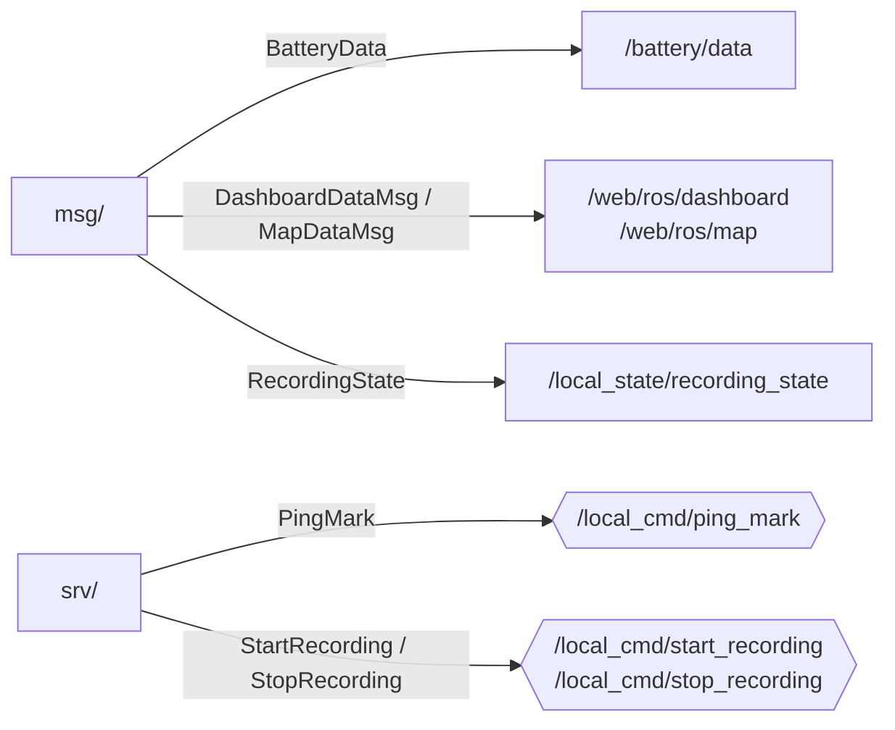

# sail_msgs — messaggi e servizi di Agir

_Aggiornato al giorno: 30/10/2026_

[English](README_ENG.md) · [Workspace](../../README.md)

## Introduzione

Per scambiare dati, due nodi devono conoscere la stessa struttura del messaggio. Questo pacchetto definisce le strutture specifiche di Agir, come i dati della dashboard, le boe e le richieste di registrazione.

Non contiene nodi e non pubblica topic. Durante la build, ROS genera dai file `.msg` e `.srv` i tipi che gli altri pacchetti importano e usano.

## Struttura del pacchetto

```text
sail_msgs/
├── msg/               BatteryData, DashboardDataMsg, MapDataMsg, Mark,
│                      RecordingState, SerialMsg
├── srv/               StartRecording, StopRecording, PingMark, ManageRecording
├── CMakeLists.txt
└── package.xml
```

I messaggi sono in [msg/](msg/) e i servizi in [srv/](srv/). [CMakeLists.txt](CMakeLists.txt) elenca le interfacce da generare: attualmente sei messaggi e quattro servizi.

## Dove vengono usate le interfacce

Le frecce associano le definizioni ai topic e servizi che le usano. Non indicano pubblicazioni da parte di `sail_msgs`: i publisher e i server appartengono agli altri pacchetti.



| Interfaccia | A cosa serve |
|---|---|
| `BatteryData` | Riunisce tensione e allarme low; l'header riguarda la lettura dell'allarme. |
| `DashboardDataMsg` | Riunisce i valori mostrati in dashboard e i flag che indicano quali sono utilizzabili. |
| `MapDataMsg` | Porta posizione, timestamp originale del GPS e lista delle boe. |
| `Mark` | Descrive una boa: Committee, Pin o Windward, con posizione GPS e header. È contenuto nella mappa e nella risposta al ping. |
| `RecordingState` | Descrive lo stato della registrazione, senza header. |
| `StartRecording`, `StopRecording` | Chiedono al manager di iniziare o terminare una registrazione. |
| `PingMark` | Chiede al telemetry gateway di memorizzare una boa; la risposta `mark` va usata solo se `success` è vero. |
| `SerialMsg`, `ManageRecording` | Interfacce legacy ancora generate, ma non usate nel percorso live attuale. |

Per le misure che hanno già un tipo adatto usiamo pacchetti ROS esistenti: `gps_msgs/GPSFix` per GPS, `sensor_msgs/Imu` per IMU, `sensor_msgs/Range` per ultrasuoni e `marti_common_msgs/Float64Stamped` per altezza. Non occorre ricrearle qui.

`Header` contiene timestamp e nome del frame. Non rende automaticamente valida o fresca una misura: i nodi controllano questi aspetti prima di usarla. Le unità e il riferimento dei campi vengono spiegati nei README dei pacchetti che producono i dati.

## Come modificare un'interfaccia

Quando aggiungi un campo o ne cambi il tipo, aggiorna i nodi che scrivono e leggono il messaggio. Se il dato arriva alla web app, aggiorna anche la conversione MQTT e il relativo consumer. Poi esegui una build pulita del workspace e i test dei pacchetti coinvolti.

Una bag o un programma compilato prima della modifica può contenere ancora lo schema precedente: non considerarlo automaticamente compatibile.

## Definizioni dei messaggi e dei servizi

Le definizioni riportate sotto permettono di leggere i campi senza aprire ogni file. I sorgenti collegati rimangono il riferimento da modificare; aggiorna anche questa sezione quando cambia uno schema.
### [BatteryData.msg](msg/BatteryData.msg)

```text
std_msgs/Header header
float32 voltage_v
bool low
```

### [DashboardDataMsg.msg](msg/DashboardDataMsg.msg)

```text
std_msgs/Header header
bool attitude_valid
float64 roll_deg
float64 pitch_deg
float64 yaw_deg
bool height_valid
float64 height_m
bool battery_valid
bool battery_low
float32 battery_voltage_v
bool sog_valid
float64 sog_mps
bool ultrasonic_left_valid
float64 ultrasonic_left_m
bool ultrasonic_right_valid
float64 ultrasonic_right_m
```

### [MapDataMsg.msg](msg/MapDataMsg.msg)

```text
std_msgs/Header header
builtin_interfaces/Time gps_stamp
bool fix_valid
float64 latitude_deg
float64 longitude_deg
float64 sog_mps
sail_msgs/Mark[] marks
```

### [Mark.msg](msg/Mark.msg)

```text
uint8 COMMITTEE=0
uint8 PIN=1
uint8 WINDWARD=2

std_msgs/Header header
uint8 type
float64 lat
float64 lon
```

### [RecordingState.msg](msg/RecordingState.msg)

```text
bool recording
string bag_name
string last_error
```

### [SerialMsg.msg](msg/SerialMsg.msg)

```text
std_msgs/Header header
uint8 id
std_msgs/UInt8MultiArray payload
```

### [ManageRecording.srv](srv/ManageRecording.srv)

```text
string name
float32 overall
float32 duration

---
bool success
string message
```

### [PingMark.srv](srv/PingMark.srv)

```text
uint8 type
---
bool success
string error_message
sail_msgs/Mark mark
```

### [StartRecording.srv](srv/StartRecording.srv)

```text
---
bool success
string error_message
string effective_bag_name
```

### [StopRecording.srv](srv/StopRecording.srv)

```text
---
bool success
string error_message
string last_bag_name
```
