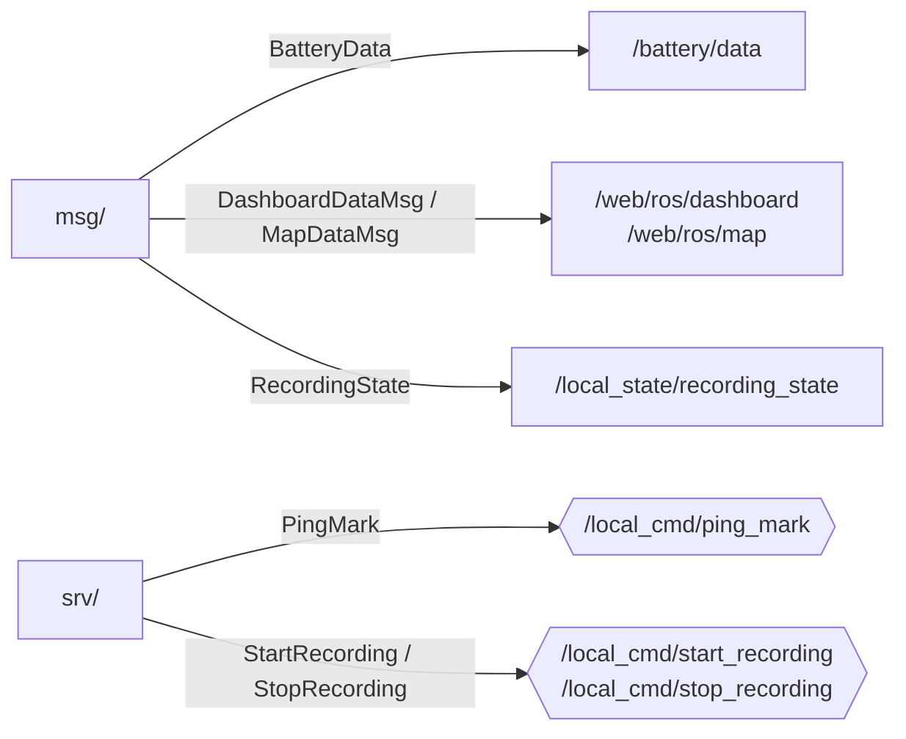

# sail_msgs — Agir messages and services

_Updated on: 30/10/2026_

[Italiano](README.md) · [Workspace](../../README_ENG.md)

## Introduction

To exchange data, two nodes must agree on a message structure. This package defines Agir-specific structures such as dashboard data, marks and recording requests.

It contains no nodes and publishes no topics. During the build, ROS generates types from `.msg` and `.srv` files for other packages to import and use.

## Package structure

```text
sail_msgs/
├── msg/               BatteryData, DashboardDataMsg, MapDataMsg, Mark,
│                      RecordingState, SerialMsg
├── srv/               StartRecording, StopRecording, PingMark, ManageRecording
├── CMakeLists.txt
└── package.xml
```

Messages live in [msg/](msg/) and services in [srv/](srv/). [CMakeLists.txt](CMakeLists.txt) lists generated interfaces: currently six messages and four services.

## Where interfaces are used

Arrows associate definitions with the topics and services using them. They do not represent publications by `sail_msgs`; publishers and servers belong to other packages.



| Interface | Purpose |
|---|---|
| `BatteryData` | Combines voltage and low alarm; its header timestamps the alarm reading. |
| `DashboardDataMsg` | Combines dashboard values with flags indicating which are usable. |
| `MapDataMsg` | Carries position, original GPS timestamp and marks. |
| `Mark` | Describes a Committee, Pin or Windward mark with GPS position and header. Included in map data and ping responses. |
| `RecordingState` | Describes recording state without a header. |
| `StartRecording`, `StopRecording` | Ask the manager to start or finish recording. |
| `PingMark` | Asks the telemetry gateway to save a mark; use response `mark` only when `success` is true. |
| `SerialMsg`, `ManageRecording` | Legacy interfaces still generated but unused in the current live path. |

Measurements with suitable existing types use ROS packages: `gps_msgs/GPSFix` for GPS, `sensor_msgs/Imu` for IMU, `sensor_msgs/Range` for ultrasound and `marti_common_msgs/Float64Stamped` for height. These do not need to be recreated here.

`Header` carries a timestamp and frame name. It does not automatically make a measurement valid or fresh; nodes check those properties before use. Producer package READMEs explain field units and reference frames.

## Changing an interface

When adding a field or changing its type, update both writers and readers. If the data reaches the web app, also update MQTT conversion and its consumer. Then perform a clean workspace build and run affected package tests.

A bag or program built before the change may retain the previous schema; do not assume automatic compatibility.

## Message and service definitions

The definitions below let you inspect fields without opening each file. Linked sources remain the files to edit; update this section whenever a schema changes.
### [BatteryData.msg](msg/BatteryData.msg)

```text
std_msgs/Header header
float32 voltage_v
bool low
```

### [DashboardDataMsg.msg](msg/DashboardDataMsg.msg)

```text
std_msgs/Header header
bool attitude_valid
float64 roll_deg
float64 pitch_deg
float64 yaw_deg
bool height_valid
float64 height_m
bool battery_valid
bool battery_low
float32 battery_voltage_v
bool sog_valid
float64 sog_mps
bool ultrasonic_left_valid
float64 ultrasonic_left_m
bool ultrasonic_right_valid
float64 ultrasonic_right_m
```

### [MapDataMsg.msg](msg/MapDataMsg.msg)

```text
std_msgs/Header header
builtin_interfaces/Time gps_stamp
bool fix_valid
float64 latitude_deg
float64 longitude_deg
float64 sog_mps
sail_msgs/Mark[] marks
```

### [Mark.msg](msg/Mark.msg)

```text
uint8 COMMITTEE=0
uint8 PIN=1
uint8 WINDWARD=2

std_msgs/Header header
uint8 type
float64 lat
float64 lon
```

### [RecordingState.msg](msg/RecordingState.msg)

```text
bool recording
string bag_name
string last_error
```

### [SerialMsg.msg](msg/SerialMsg.msg)

```text
std_msgs/Header header
uint8 id
std_msgs/UInt8MultiArray payload
```

### [ManageRecording.srv](srv/ManageRecording.srv)

```text
string name
float32 overall
float32 duration

---
bool success
string message
```

### [PingMark.srv](srv/PingMark.srv)

```text
uint8 type
---
bool success
string error_message
sail_msgs/Mark mark
```

### [StartRecording.srv](srv/StartRecording.srv)

```text
---
bool success
string error_message
string effective_bag_name
```

### [StopRecording.srv](srv/StopRecording.srv)

```text
---
bool success
string error_message
string last_bag_name
```
