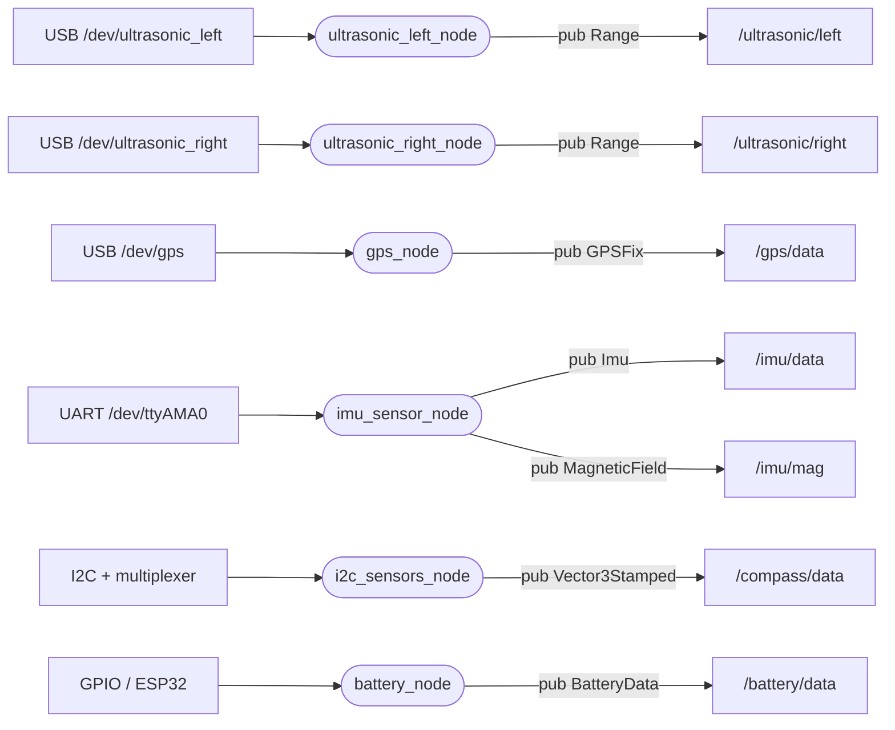

# sensors — acquisizione dei sensori

_Aggiornato al giorno: 30/10/2026_

[English](README_ENG.md) · [Workspace](../../README.md)

## Introduzione

Questo pacchetto è il punto di contatto tra ROS e l'hardware della barca. Legge ultrasuoni, GPS, IMU, bussola e batteria, interpreta i dati ricevuti e pubblica messaggi che gli altri pacchetti possono usare senza conoscere il protocollo del sensore.

Ogni collegamento ha il proprio nodo. Per esempio, i due ultrasuoni usano lo stesso codice ma due istanze diverse, ciascuna con la propria porta. Non c'è un nodo centrale che legge tutti i sensori da una seriale condivisa.

## Struttura del pacchetto

```text
sensors/
├── config/           params.yaml, endpoints.yaml
├── launch/           live_sensors.launch.py, replay_sensors.launch.py
├── sensors/
│   ├── drivers/      ultrasonic, GPS, IMU, compass, battery, I2C mux
│   ├── generated/    ros_endpoints.py
│   ├── utils/        configuration.py
│   └── *_node.py
├── test/
├── package.xml
└── setup.py
```

I file `*_node.py` gestiscono ROS, timer e messaggi; i [driver](sensors/drivers/) gestiscono i protocolli hardware. [params.yaml](config/params.yaml) contiene porte, frequenze e soglie. [endpoints.yaml](config/endpoints.yaml) contiene i nomi dei topic, da cui la build genera le costanti in `generated/`. Per cambiare un nome modifica lo YAML e ricompila.

## Nodi e topic

Nel diagramma gli ovali sono nodi, i rettangoli indicano hardware o topic. Le frecce `pub` vanno dal nodo al topic pubblicato. Questi nodi acquisiscono dall'hardware: non si sottoscrivono ai topic di altri pacchetti.



| Nodo | Collegamento predefinito | Lettura | Pubblicazione | Età massima |
|---|---|---|---|---|
| `ultrasonic_left_node` | USB, 9600 baud | All'arrivo dei dati | 20 Hz | 0,5 s |
| `ultrasonic_right_node` | USB, 9600 baud | All'arrivo dei dati | 20 Hz | 0,5 s |
| `gps_node` | USB, 230400 baud | All'arrivo dei dati | 10 Hz | 1 s |
| `imu_sensor_node` | UART, 3000000 baud | All'arrivo dei dati | 50 Hz | 0,5 s |
| `i2c_sensors_node` | Bus 1, mux 0x70, canale 0, bussola 0x0E | 10 Hz | 10 Hz | 0,5 s |
| `battery_node` | gpiochip0, linee 6 e 13 | Allarme a 10 Hz; tensione su eventi | 10 Hz | Allarme 0,5 s; tensione 5 s |

I numeri GPIO indicano le linee usate dal driver, non i numeri dei pin sul connettore. I valori della tabella sono i default dello YAML, da confrontare con il cablaggio effettivo.

## Lettura, pubblicazione e freschezza

La **lettura** acquisisce una misura dal dispositivo; la **pubblicazione** la rende disponibile su ROS. Sono due operazioni distinte. Con `publish_rate_hz: 20.0`, per esempio, il nodo degli ultrasuoni pubblica ogni 50 ms l'ultima misura disponibile, anche se nel frattempo non ne è arrivata una nuova.

Per questo una ripetizione conserva il timestamp originale: ripubblicare un numero non lo rende una nuova misura. Il controllo di [sail_common](../sail_common/README.md) impedisce di continuare a pubblicarlo oltre l'età ammessa. Quando non arrivano più campioni utilizzabili, il nodo smette di pubblicare; i consumatori devono a loro volta controllare l'età dell'ultimo dato ricevuto.

Nei nodi seriali `read_rate_hz: 0.0` significa attendere i dati in un thread dedicato. Un valore positivo regola quanto spesso il software controlla la porta, ma non cambia la frequenza fisica del sensore. Per bussola e allarme batteria il valore di lettura deve invece essere positivo.

## Cosa fa ciascun nodo

### Ultrasuoni

[ultrasonic_node.py](sensors/ultrasonic_node.py) usa il [driver A02YYUW](sensors/drivers/ultrasonic_driver.py) per riconoscere frame di quattro byte, verificarne il checksum e convertire i millimetri in metri. I frame incompleti vengono conservati fino alla lettura successiva.

Il messaggio è `sensor_msgs/msg/Range`: `range` contiene la distanza grezza, con limiti predefiniti 0,03–4,5 m e campo visivo 0,1 rad. Non è ancora l'altezza della barca: quella viene calcolata in [data_elaboration](../data_elaboration/README.md).

Il timestamp viene assegnato sul Raspberry alla lettura. Il sensore non lo trasmette. `timeout_s: 0.1` limita l'attesa della seriale quando non ci sono dati; non imposta una misura ogni 0,1 s.

### GPS

[gps_node.py](sensors/gps_node.py) legge i messaggi UBX NAV-PVT attraverso pyubx2 e li converte in `gps_msgs/msg/GPSFix`. Soltanto un nuovo NAV-PVT aggiorna la misura: altri messaggi NMEA o UBX non rendono recente un vecchio fix.

| Campo | Come viene usato |
|---|---|
| `header`, `status.header` | Istante di ricezione ROS e frame `gps`, conservati nelle ripetizioni. |
| `status.status` | FIX = 0 oppure NO_FIX = -1. |
| `latitude`, `longitude` | Coordinate WGS84 in gradi; NaN se il fix non è valido. |
| `speed` | Speed over ground, in m/s. |
| `track` | Course over ground, in gradi: indica il movimento, non la prua da fermo. |
| `altitude` | Quota NAV-PVT hMSL in metri, quando utilizzabile; altrimenti NaN. |
| `pdop`, `status.satellites_used` | Diluizione geometrica e numero di satelliti usati. |
| `err`, `err_horz`, `err_vert`, covarianza | Errori lasciati a NaN e covarianza sconosciuta: il driver non converte le accuratezze in intervalli al 95%. |
| `time`, altri DOP | Tempo GPS non ricostruito (NaN); DOP non disponibili a -1. |

Un NAV-PVT recente senza fix viene pubblicato come NO_FIX. Se invece non arriva più NAV-PVT, il nodo smette di pubblicare dopo il timeout. Freschezza e validità del fix sono quindi due controlli diversi. La frequenza di pubblicazione non riprogramma il ricevitore; dopo una disconnessione USB può essere necessario riavviare il nodo, perché qui non è prevista la riapertura automatica.

### IMU BNO085

[imu_sensor_node.py](sensors/imu_sensor_node.py) usa il [driver UART](sensors/drivers/imu_driver.py) SH-2/SHTP, non UART-RVC. Il collegamento previsto usa PL011 su GPIO14/15, con P1 alto e P0 basso sul sensore.

Con `rotation_vector` il BNO085 esegue già la fusione di accelerometro, giroscopio e magnetometro. Il nodo pubblica quaternione, accelerazione con gravità in m/s² e velocità angolare in rad/s nel messaggio `Imu`; il campo magnetico è pubblicato separatamente in tesla.

Il driver richiede orientamento, accelerazione e gyro a 100 Hz e magnetometro a 50 Hz; il timer ROS pubblica a 50 Hz. Queste frequenze non sono equivalenti e i report non sono necessariamente simultanei. Un nuovo orientamento viene combinato con le altre componenti solo se sono recenti; la componente più vecchia limita la freschezza del risultato.

Il tempo interno SH-2 non è convertito in tempo ROS: l'header viene assegnato dall'host durante la composizione del campione. Errori seriali svuotano i dati memorizzati; il driver ritenta dopo 2 s e riconnette dopo 1 s di silenzio UART. Il magnetometro ha una scadenza separata.

`game_rotation_vector` non usa il riferimento magnetico: cambiarlo modifica il significato dello yaw. La correzione del montaggio e del braccio avviene nel pacchetto di elaborazione. Il livello di accuratezza 0–3 viene scritto nei log; covarianze a zero non significano precisione perfetta.

### Bussola separata

[i2c_sensors_node.py](sensors/i2c_sensors_node.py) legge la bussola attraverso il multiplexer. La selezione del canale, il comando di misura, l'attesa e la lettura sono protetti dallo stesso lock, così non si cambia canale a metà operazione.

`conversion_delay_s: 0.02` è l'attesa prevista dal driver dopo il comando di misura. Non sostituisce il controllo di freschezza e non garantisce da sola la validità del dato.

Il messaggio `Vector3Stamped` contiene conteggi grezzi con segno, non tesla. Attualmente questa bussola viene acquisita per diagnostica e registrazione: non entra nella fusione del BNO085 né nello yaw della dashboard.

### Batteria

[battery_node.py](sensors/battery_node.py) legge l'allarme low dal GPIO e riceve dal [driver](sensors/drivers/battery_driver.py) la tensione trasmessa dall'ESP32 tramite eventi GPIO. Pubblica `BatteryData`, con header, tensione e allarme.

L'header indica quando è stato letto l'allarme. Se la tensione manca o ha più di 5 s, viene pubblicata come NaN, mentre un allarme recente può continuare a essere inviato. Gli errori GPIO impediscono di creare un nuovo campione.

Il nodo conta le letture consecutive con allarme attivo. Con i default `low_samples_required: 1` e `shutdown_enabled: true`, richiede lo spegnimento una sola volta al raggiungimento della soglia. Il comando viene eseguito nel container: lo spegnimento effettivo dell'host deve essere verificato sulla configurazione di bordo.

## Avvio e test

Il [launch live](launch/live_sensors.launch.py) avvia le sei istanze descritte sopra. Dal container, con ROS e workspace caricati:

```bash
ros2 launch sensors live_sensors.launch.py
```

Puoi usare un altro file di parametri con `sensors_params_file:=/percorso/params.yaml`. I parametri vengono applicati all'avvio: dopo aver aggiornato quelli del repository, ricompila e riavvia i nodi. Non avviare due istanze che leggono la stessa porta.

Nel replay non si avviano i sensori: la bag fornisce direttamente le misure ai pacchetti successivi.

Da `/home/ros/ros2_ws`, esegui `bash scripts/test.sh sensors`. I test simulano l'hardware; sulla barca verifica anche cablaggio, permessi, frequenze osservate e comportamento quando un sensore smette di inviare dati.