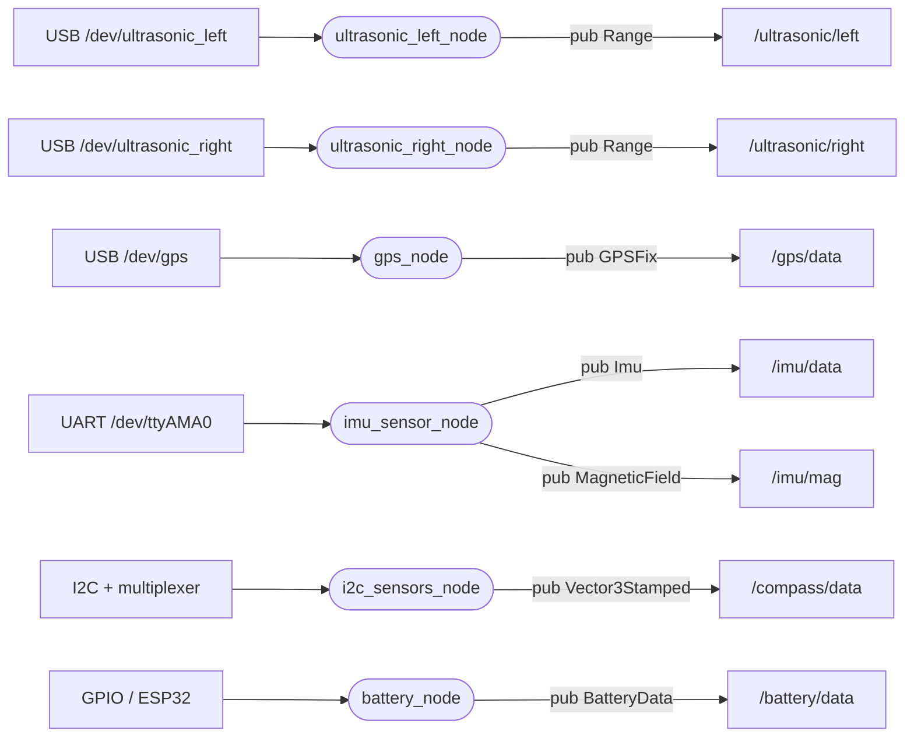

# sensors — sensor acquisition

_Updated on: 30/10/2026_

[Italiano](README.md) · [Workspace](../../README_ENG.md)

## Introduction

This package connects ROS to the boat's hardware. It reads ultrasound, GPS, IMU, compass and battery data, interprets the incoming measurements and publishes messages that other packages can use without knowing each sensor protocol.

Each connection has its own node. The ultrasonic sensors, for example, use two instances of the same code, each with its own port. There is no central node reading all sensors from a shared serial stream.

## Package structure

```text
sensors/
├── config/           params.yaml, endpoints.yaml
├── launch/           live_sensors.launch.py, replay_sensors.launch.py
├── sensors/
│   ├── drivers/      ultrasonic, GPS, IMU, compass, battery, I2C mux
│   ├── generated/    ros_endpoints.py
│   ├── utils/        configuration.py
│   └── *_node.py
├── test/
├── package.xml
└── setup.py
```

The `*_node.py` files handle ROS, timers and messages; [drivers](sensors/drivers/) handle hardware protocols. [params.yaml](config/params.yaml) contains ports, rates and thresholds. [endpoints.yaml](config/endpoints.yaml) defines topic names, from which the build generates constants in `generated/`. Edit that YAML and rebuild to change a name.

## Nodes and topics

Ovals are nodes; rectangles represent hardware or topics. Arrows labelled `pub` point from a node to its published topic. These nodes acquire hardware data and do not subscribe to topics from other packages.



| Node | Default connection | Reading | Publication | Maximum age |
|---|---|---|---|---|
| `ultrasonic_left_node` | USB, 9600 baud | On incoming data | 20 Hz | 0.5 s |
| `ultrasonic_right_node` | USB, 9600 baud | On incoming data | 20 Hz | 0.5 s |
| `gps_node` | USB, 230400 baud | On incoming data | 10 Hz | 1 s |
| `imu_sensor_node` | UART, 3000000 baud | On incoming data | 50 Hz | 0.5 s |
| `i2c_sensors_node` | Bus 1, mux 0x70, channel 0, compass 0x0E | 10 Hz | 10 Hz | 0.5 s |
| `battery_node` | gpiochip0, lines 6 and 13 | Alarm at 10 Hz; voltage from events | 10 Hz | Alarm 0.5 s; voltage 5 s |

GPIO numbers identify driver lines, not physical connector pins. These are YAML defaults and must match the actual wiring.

## Reading, publishing and freshness

**Reading** acquires a measurement from the device; **publishing** exposes it through ROS. With `publish_rate_hz: 20.0`, for example, an ultrasonic node publishes the latest available measurement every 50 ms, even if no new one has arrived.

A repeated measurement therefore retains its original timestamp. The [sail_common](../sail_common/README_ENG.md) check prevents publishing it beyond its allowed age. When usable samples stop arriving, publication stops; consumers must also check the age of their last received sample.

For serial nodes, `read_rate_hz: 0.0` waits for data in a dedicated thread. A positive value controls how often software checks the port, without changing the sensor's physical measurement rate. Compass reading and battery alarm polling require a positive rate.

## What each node does

### Ultrasound

[ultrasonic_node.py](sensors/ultrasonic_node.py) uses the [A02YYUW driver](sensors/drivers/ultrasonic_driver.py) to recognize four-byte frames, check their checksum and convert millimetres to metres. Partial frames are retained for the next read.

The output is `sensor_msgs/msg/Range`: `range` is the raw distance, with default limits of 0.03–4.5 m and a 0.1 rad field of view. It is not boat height, which is calculated by [data_elaboration](../data_elaboration/README_ENG.md).

The Raspberry assigns the timestamp when reading; the sensor does not transmit one. `timeout_s: 0.1` bounds idle serial waits rather than setting the sensor measurement interval.

### GPS

[gps_node.py](sensors/gps_node.py) reads UBX NAV-PVT using pyubx2 and converts it to `gps_msgs/msg/GPSFix`. Only a new NAV-PVT updates the measurement; other NMEA or UBX messages cannot make an old fix fresh.

| Field | Current use |
|---|---|
| `header`, `status.header` | ROS receipt time and `gps` frame, retained on repeat publication. |
| `status.status` | FIX = 0 or NO_FIX = -1. |
| `latitude`, `longitude` | WGS84 degrees; NaN for an invalid fix. |
| `speed` | Speed over ground, in m/s. |
| `track` | Course over ground in degrees: movement direction, not stationary heading. |
| `altitude` | NAV-PVT hMSL in metres when usable; otherwise NaN. |
| `pdop`, `status.satellites_used` | Geometric dilution and number of satellites used. |
| `err`, `err_horz`, `err_vert`, covariance | Errors remain NaN and covariance unknown; accuracy estimates are not converted into 95% intervals. |
| `time`, other DOPs | GPS time is not reconstructed (NaN); unavailable DOPs are -1. |

A recent NAV-PVT without a fix is published as NO_FIX. If NAV-PVT stops arriving, publication stops after the timeout. Freshness and fix validity are separate checks. Publication rates do not reprogram the receiver; USB disconnection may require restarting this node because automatic reopening is not implemented here.

### BNO085 IMU

[imu_sensor_node.py](sensors/imu_sensor_node.py) uses the SH-2/SHTP [UART driver](sensors/drivers/imu_driver.py), not UART-RVC. Expected wiring uses PL011 on GPIO14/15, with sensor P1 high and P0 low.

With `rotation_vector`, the BNO085 already fuses accelerometer, gyroscope and magnetometer data. The node publishes a quaternion, acceleration including gravity in m/s² and angular velocity in rad/s in `Imu`; magnetic field is published separately in tesla.

The driver requests orientation, acceleration and gyro reports at 100 Hz and magnetometer reports at 50 Hz; the ROS publication timer runs at 50 Hz. These rates differ, and reports are not necessarily simultaneous. A new orientation is combined with other components only while they are recent; the oldest component limits the result's freshness.

Internal SH-2 time is not mapped to ROS time: the host assigns the header while assembling the sample. Serial errors clear cached data; retries wait 2 s and 1 s of UART silence triggers reconnection. Magnetometer data expires independently.

`game_rotation_vector` does not use the magnetic reference, so selecting it changes yaw semantics. Mounting and lever-arm correction happen in the processing package. Accuracy level 0–3 is logged; zero covariances do not mean perfect accuracy.

### Separate compass

[i2c_sensors_node.py](sensors/i2c_sensors_node.py) reads the compass through the multiplexer. One lock covers channel selection, measurement command, waiting and reading, preventing channel changes during a transaction.

`conversion_delay_s: 0.02` is the driver's wait after requesting a measurement. It neither replaces freshness checking nor guarantees valid data on its own.

The `Vector3Stamped` message contains signed raw counts, not tesla. This compass is currently acquired for diagnostics and recording; it is not part of BNO085 fusion or dashboard yaw.

### Battery

[battery_node.py](sensors/battery_node.py) reads the low alarm GPIO and obtains voltage from the [driver](sensors/drivers/battery_driver.py), which decodes ESP32 GPIO events. It publishes `BatteryData`, containing a header, voltage and alarm.

The header timestamps the alarm read. Missing voltage or voltage older than 5 s becomes NaN, while a fresh alarm can still be published. GPIO errors prevent creating new samples.

The node counts consecutive active-alarm reads. With defaults `low_samples_required: 1` and `shutdown_enabled: true`, it requests shutdown once when the threshold is reached. That command executes inside the container; actual host shutdown must be verified on the onboard configuration.

## Startup and tests

The [live launch](launch/live_sensors.launch.py) starts the six instances above. Inside the container, with ROS and the workspace sourced:

```bash
ros2 launch sensors live_sensors.launch.py
```

Override parameters with `sensors_params_file:=/path/to/params.yaml`. Parameters are applied at startup: after editing repository YAML, rebuild and restart nodes. Do not start two instances owning the same port.

Replay does not start acquisition nodes; the bag supplies measurements directly to downstream packages.

From `/home/ros/ros2_ws`, run `bash scripts/test.sh sensors`. Tests simulate hardware; on the boat also check wiring, permissions, observed rates and behaviour when a sensor stops sending data.